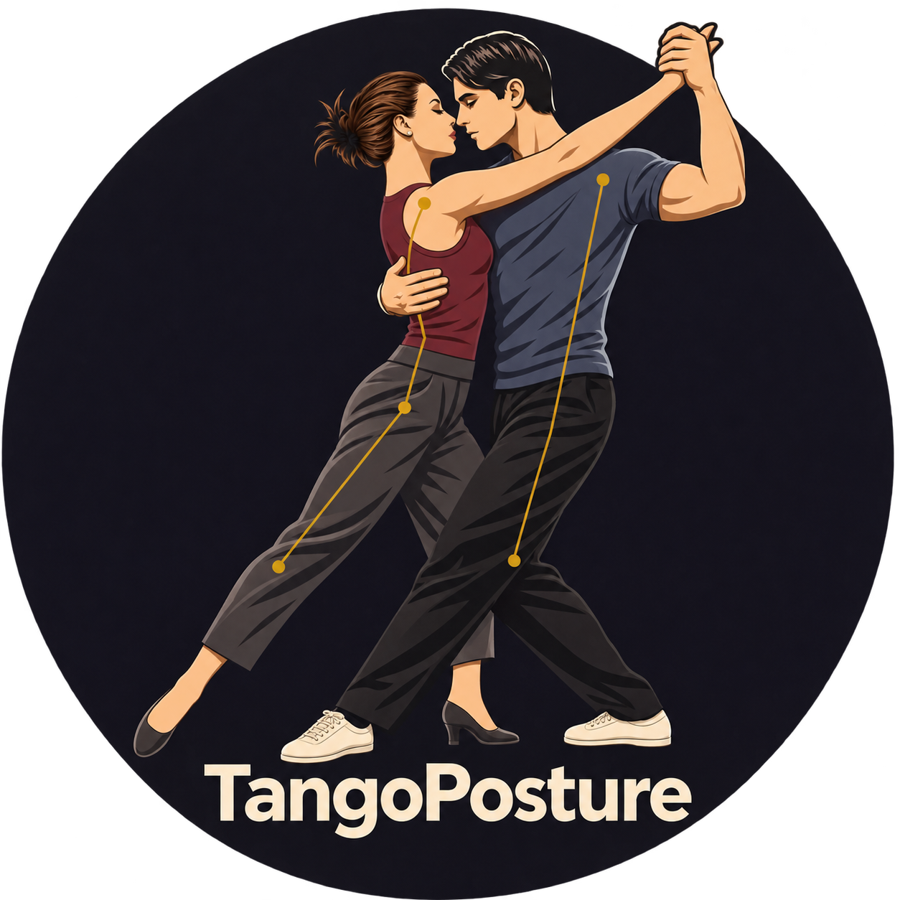
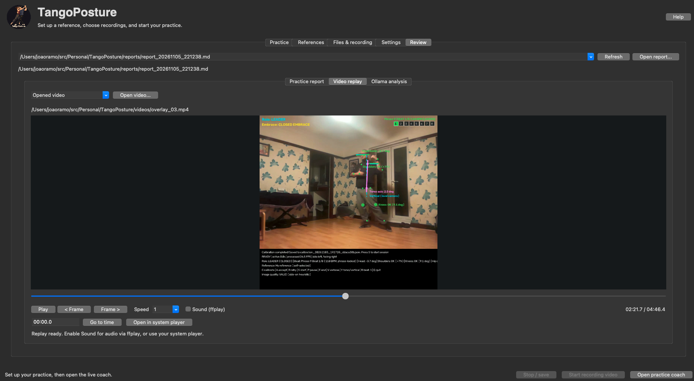

# Tango Posture Coach

<p align="center"></p>

A local Python desktop coach and movement analysis tool for Argentine Tango dancers. It combines real-time MediaPipe Pose tracking (`pose_landmarker_lite.task`) with live microphone audio analysis to monitor **head horizontal alignment**, **shoulder tension**, **Leader/Follower role & Closed/Open embrace**, **closed-embrace knee flexion**, **central spine axis (front, side steps, and 360° pivots)**, and **8-beat Argentine Tango musical phrases**, while saving synchronized audio+video recordings and post-run Markdown reports.

Practice and pose analysis run locally without an account or API key after installation
and pose-model setup. Optional report interpretation connects to your configured Ollama server.

Visit the [TangoPosture community website](https://tangoposture-community.correia-ramos.chatgpt.site/).



**Experimental movement observation, not medical assessment or a judgement of artistic tango quality.** See the [Tango Posture Coach Manual](docs/TANGO_POSTURE_GUIDE.md) for one guide to practice, references, reports, configuration, examples, and limitations. Open **Help → Search & browse Tango Posture Manual** in the desktop app for the same guide with search and section navigation.

---

## Key Features Added

1. **All-Angle Calibration & 360° Pivot / Side-Step Support (`allow_all_angles=true`)**
   - Calibrate and practice **facing the camera**, in **side-on profile**, or while executing **side steps (*pasos al costado*), ochos, and 360° pivots** without losing tracking.
   - Uses your central spine axis (midpoint of shoulders to midpoint of hips) when both sides are visible, and seamlessly falls back to the visible side during pivots.
2. **Dedicated Calibration Camera & Reference Archives (`calibrations/`)**
   - Pressing `C` speaks **"Calibration starting"**, gives you a **3-second countdown** to get into position, plays a **1-second beep** throughout the 12-second capture window, and announces **"Calibration completed"** (or speaks the specific reason if calibration failed).
   - **References > Open calibration camera** opens a dedicated camera window. A valid capture saves `calibrations/<reference name>.tpc`, containing raw video, overlay video, and `reference.json`. Capturing again with the same name replaces that archive rather than adding recordings; failed captures preserve the previous valid file.
3. **Head Horizontal Alignment & Neutral Camera Offset**
   - Draws a cyan horizontal reference line from the ear and a live ear-to-nose pitch vector (`Head horiz: +0.0 deg`).
   - Compensates for natural ear-to-nose landmark geometry and camera tilt via `head_neutral_offset=-12.0` (or auto-zeroes to your calibrated straight posture) and triggers a red **`BAD HEAD ALIGNMENT`** alert when the head drops below `head_down_angle` (`-15.0 deg`) for longer than `head_down_duration` (`3.0s`).
4. **Shoulder Tension Detection (`LOWER YOUR SHOULDERS`)**
   - Measures camera-distance-invariant vertical neck clearance (`shoulder.y - ear.y` normalized by rigid skull/body scale) on both shoulders.
   - Flags **`LOWER SHOULDERS (+XX%)`** with a downward arrow on the shoulder as soon as elevation crosses `shoulder_raise_threshold`, and displays a red **`LOWER YOUR SHOULDERS`** banner after `shoulder_tension_duration` (`1.5s`).
5. **Leader / Follower Role Recognition with Hysteresis**
   - Automatically identifies **`LEADER`** (left arm raised, right arm horizontal) or **`FOLLOWER`** (right arm raised, left arm horizontal).
   - Uses configurable hysteresis (`role_assign_ms=300` to assign from `NONE`, `role_hold_ms=5000` to hold the role across turns/pivots before returning to `NONE`).
6. **Closed vs. Open Embrace & Closed-Embrace Knee Bend Check**
   - Classifies active embraces as **`CLOSED EMBRACE`** or **`OPEN EMBRACE`** (`embrace_closed_threshold=0.72`) and displays `Embrace: CLOSED EMBRACE` or `Embrace: OPEN EMBRACE` directly below the `Role:` label.
   - When in **`CLOSED EMBRACE`**, monitors knee flexion (`180° - hip–knee–ankle angle`). If your knees are locked/straighter than `closed_embrace_min_knee_bend` (`6.0 deg`), it highlights the knee joints on the overlay (`BEND KNEES`) and triggers a red **`BEND YOUR KNEES IN CLOSED EMBRACE`** alert after `knee_straight_duration` (`1.5s`).
7. **Argentine Tango 8-Beat Musical Phrase Tracker**
   - **Silence / No Music Gate**: Displays **`WAITING FOR SONG TO BEGIN...`** with all `1..8` beat boxes unlit (`beat = 0`, `phrase = 0`) when no music is playing.
   - **30-Second Phrase-Start Analysis**: As soon as a song is detected on the microphone, starts a 30-second analysis window (`UNDERSTANDING BEATS (0/30s -> 30/30s)`) using scale-invariant multi-band spectral flux and 8-beat harmonic comb autocorrelation while progressing through beats `1 -> 2 -> ... -> 8` in green.
   - **Phrase Lock**: Locks onto **Beat 1** of each 8-beat tango phrase (`Phrase N | BEAT 1..8 | YYY BPM [LOCKED]`) and pauses immediately when the music stops.
8. **Portable Practice Archives (`practice/`) & Numbered Recordings**
   - Saves each named practice as a ZIP archive with a `.tp` extension. Each recording includes raw video, annotated overlay, report, and metadata, numbered from `00`.
   - Embeds recorded microphone audio into video via native macOS `AVFoundation` muxing when supported (no separate `.wav` files left behind).
   - Full-width video display (`>= 960 px` wide) with no black side margins.
9. **Per-Recording Markdown Reports**
   - Each saved recording has a report inside its `.tp` archive, with embrace role/type intervals, alignment metrics, and an issues timeline linked to the matching raw and overlay videos.

---

## Install

Tested on macOS (Apple Silicon arm64), Python 3.11. Install [uv](https://github.com/astral-sh/uv), then from this repository:

```bash
uv python install 3.11
uv sync --frozen
uv run tango-posture --help
uv run tango-posture models fetch
```

`models fetch` is an explicit setup operation. It downloads only the versioned model in `models/manifest.json`, verifies SHA-256, and atomically installs it. Runs never download models. For offline installation, transfer that exact verified file yourself and pass `--model-path /path/to/pose_landmarker_lite.task`. Every run verifies its checksum.

The pinned MediaPipe 0.10.30 release supports the Tasks API without pulling in a second OpenCV package. See [wheel evidence](docs/wheel_compatibility.json), [third-party notices](THIRD_PARTY_NOTICES.md), and the [model manifest](models/manifest.json). Original application code is Apache-2.0; dependency and model terms remain separate.

---

## Webcam Practice Workflow

### Option 1: Graphical Practice Studio (Recommended)

Open the native desktop interface with any of these commands:

```bash
./run_practice.sh
uv run tango-posture
uv run tango-posture gui
```

Startup shows a branded splash screen for three seconds with a busy cursor and
animated waiting indicator. **About** (or **Help > About TangoPosture**) shows the
application version, license, and a clickable GitHub repository link.

The **Practice** tab selects a camera or video and shows the run log; it also offers
video analysis without a live preview. **References**
lets you name a calibration and open its dedicated camera window, choose saved
`.tpc` references (with legacy JSON/SQLite support), or define a reference interval
in a video. Press **C** in the calibration window to capture or retry, then close
it. The saved `.tpc` becomes the selected reference; the coach reads its embedded
`reference.json`. Use **Match reference
camera settings** to restore the recorded side, facing, resolution, and capture
profile. Confirm physical camera placement each time you reuse a reference.

**Files & recording** controls model/data paths and the **Practice name**.
Practices are saved as `practice/<name>.tp`; an existing name appends recordings
without replacing earlier segments. **New practice name** starts a separate archive.
**Settings** groups configuration values into camera/view, quality/calibration,
tracking, head/shoulders, embrace/knees, hip offset, music, and review/Ollama tabs. The Settings menu
imports/exports TOML; the File menu also imports/exports TOML and saves
complete practice presets, including filenames and reference choices.

Click **Open practice coach** for a live preview with Calibrate, Accept, Record,
Start scoring, Pause/resume, Stop recording/save, Beat 1, Skeleton, Torso axis, Quit/save,
and Abort/exit buttons.
**C** captures or retries calibration; **R / Record** starts video recording in
the coach window. **S** starts reference-based scoring and session
statistics, not video recording, and requires an accepted reference. **E** stops
and saves recording and scoring while keeping the preview open; **Q** saves and
quits. Press **R** again after **E** to add another recording to the same practice.
The existing keyboard shortcuts work in this window too. Settings changes apply to
the next run; closing the coach releases capture and saves reports and recordings.

**Abort / exit (X)** closes the coach and discards the current unsaved video, overlay,
report, and scoring session. Previously saved segments remain intact; Abort requires
confirmation and does not show the saved-file popup.

Tick **Automatically record songs** in the coach to record when the live microphone
detects music and save when it detects a sustained stop. It repeats for subsequent
songs while checked, appending numbered recordings to the same `.tp` file. Unchecking
it saves an active automatic recording and stops automation. This option requires
camera mode, enabled beat tracking, and a usable microphone; it does not use clock
or tap-tempo fallback as evidence of a song.

Set the following under **Settings > Music** (also accessible from the coach's
**Parameters > Music recording parameters** menu). Changes apply to the next run:

| Parameter | Default | Meaning |
| --- | --- | --- |
| `auto_record_start_delay` | 1 second | Continuous detected music before starting |
| `auto_record_stop_delay` | 3 seconds | Continuous detector silence before stopping/saving |
| `max_recordings` | 10 | Maximum manual or automatic recordings started in one coach run |

Short silent gaps below the stop delay do not split a recording. Song detection is
heuristic; the configured delays apply after the detector reports music or silence.

The GUI needs a desktop display and Python's Tk support (check with
`uv run python -m tkinter`). Headless processing continues to use the CLI below.

### Read reports, replay recordings, and review with Ollama

The **Review** tab opens saved practices and calibrations automatically. Select a `.tp` or `.tpc` archive
from the list or **Open practice**, then choose **Recording 00**, **Recording 01**,
and so on to load its matching report and videos. A `.tpc` has one **Calibration**
entry showing its reference values/JSON and raw/overlay videos. **Refresh** finds saved practices and calibrations
in the selected data directory. Legacy Markdown reports remain readable. Reports have formatted
headings, search, line wrapping, and clickable timestamps.

New recordings include a third **Full lines + messages** video: the complete skeleton and alignment cues on a plain background. Frame notes appear in the live coach and replay sidebar, leaving the video area free of the footer. Older recordings retain their baked-in footer.

Under **Video replay**, use **Compare alongside** to show one or more views with shared playback, speed, frame stepping, and seeking. Switch between **Raw video**, **Overlay**, and **Full lines + messages** for the selected
recording. Archive contents are extracted temporarily and removed when closed.
Play/pause, step through frames, scrub the timeline, change
speed, or enter a time such as `01:12.5`. Clicking a report timestamp seeks to that
moment. Metadata inside the `.tp` archive associates each report with its recordings and
frame timeline, accounting for dropped capture frames when seeking recorded videos.
Older Markdown reports still open through their existing video links; timestamp
seeking for these reports is approximate. Use **Open video** to locate moved files.

Video replay is silent by default. Enable **Sound (ffplay)** for optional audio
when FFmpeg's `ffplay` and an audio output device are available. Audio and Tk video
use separate playback clocks; the **system player** button is available for normal
audio/video playback and synchronization. Pause and seeking stop/restart optional audio.

In **Ollama analysis**, set the server URL and a chat model, optionally use **List
installed models**, enter an analysis focus, then click **Analyze report**. The
report text is sent on this action; video files are not uploaded. Responses stream
into the app without blocking practice controls. Example setup on the machine
running Ollama:

```bash
ollama serve
# In another terminal, install a model once (or use one you already have):
ollama pull llama3.2
```

The default URL is `http://127.0.0.1:11434`, which means the machine running this
application. Configure another reachable server when Ollama runs elsewhere.
Settings and presets retain the server, model, instruction, timeout, temperature,
context size, report character limit, and output-token limit. TOML examples:

```toml
ollama_base_url="http://127.0.0.1:11434"
ollama_model="llama3.2"
ollama_timeout=120
ollama_num_ctx=16384
ollama_num_predict=2048
```

Completed analyses are stored inside the practice archive alongside their report as `.analysis-*.json`, with
the report hash, model, endpoint, instructions, and generation time. Reopen them
from **Saved analyses**, or export Markdown. They never replace the measured report
and are shown only for the matching report content. Cancelled/failed partial
responses are not saved; output that reaches the model's generation limit is
labelled incomplete. No analysis is sent automatically and no models are downloaded
by the app. Interpretation should be checked against report coverage and the video.

### Option 2: Direct CLI Execution

```bash
uv run tango-posture run --camera 0 --side left --facing right
# Open a named practice; R records, E saves a segment, Q saves and quits
uv run tango-posture run --camera 0 --side left --facing right \
   --practice-name 'Evening practice'
# Use the CLI launcher:
./run_practice.sh --cli --calibration latest --confirm-camera-unchanged
```

On macOS, grant Camera and Microphone access to the terminal/application that launches Python in **System Settings → Privacy & Security**.

### Interactive Controls

| Key | Action |
| --- | --- |
| `C` | Start guided calibration (spoken `"Calibration starting"`, 3s positioning wait, 12s capture with 1s beeps, auto-saved to `calibrations/`) |
| `A` | Accept a displayed calibration (when reviewing a video reference interval) |
| `R` | Record raw video and overlay; after E, record the next segment in the same practice |
| `S` | Start an evaluated practice session against the active reference |
| `P` | Pause/resume session; pause time is excluded |
| `B` | Manually sync Argentine Tango **Beat 1** / tap tempo (`1..8` phrase counter) |
| `E` | Stop recording/scoring and save the segment to the `.tp` archive; keep the preview open |
| `Q` / window close / `Ctrl+C` | Save the current segment and quit |
| `X` | Confirm Abort, discard the current unsaved recording/scoring session, and exit the coach |
| `V` | Confirm unmirrored facing direction and enable requested display mirroring |
| `Y` | Show/hide the torso axis and vertical reference |

### Torso axis overlay

The solid **magenta torso axis** joins the midpoint of your hips to the midpoint of
your shoulders and extends slightly beyond both. The **dashed cyan vertical** runs
through your hip midpoint. `Torso axis: X deg` shows the magnitude of the torso's
image-plane tilt from vertical, corrected for the video's aspect ratio. These cues
work in both live and recorded overlays, including mirrored displays. Head movement
and stepping feet do not define this axis. Both lines hide when any of the four
shoulder/hip landmarks is missing or below the configured confidence threshold.

Keep the camera level: the vertical is an image reference, not a measured gravity
direction. This overlay shows torso orientation, not your centre of mass or which
foot carries your weight. The existing ankle-to-head hip-offset calculation remains
separate, labelled **Hip offset** in the overlay status; its calibration, thresholds,
and report fields are unchanged.

---

## App Settings & TOML

All application parameters are editable in **Settings**, using the same names as
[configs/default.toml](configs/default.toml). The default TOML includes every editable
parameter. Use **Settings > Import settings TOML** or **Export settings TOML** to
load/save them, or save a complete practice preset.

Configuration precedence is app defaults, then an explicitly selected TOML file,
then CLI options. Coach runs use a snapshot of the app's current settings. `.env`
files and process environment variables are ignored; `--ignore-env` has been removed.
Start normally with `uv run tango-posture gui`, or choose a file with
`uv run tango-posture --config configs/default.toml gui`. Practice presets never
automatically confirm camera placement.

Common settings:

| Setting | Default | Description |
| --- | --- | --- |
| `head_neutral_offset` | `-12.0` | Compensates for camera tilt and ear-to-nose landmark offset when standing straight (`0.0 deg` = level) |
| `head_down_angle` | `-15.0` | Downward head pitch threshold (below neutral `0.0 deg`) that flags downward head tilt |
| `head_down_duration` | `3.0` | Seconds below `head_down_angle` before triggering red `BAD HEAD ALIGNMENT` alert |
| `shoulder_neutral_clearance` | `1.05` | Relaxed vertical ear-to-shoulder clearance ratio when running uncalibrated (`0%` tension baseline) |
| `shoulder_raise_threshold` | `10.0` | Shoulder elevation `%` above neutral that flags `LOWER SHOULDERS (+XX%)` |
| `shoulder_tension_duration` | `1.0` | Seconds above `shoulder_raise_threshold` before triggering red `LOWER YOUR SHOULDERS` alert |
| `role_assign_ms` | `300` | Milliseconds of continuous detection required to transition from `NONE` to `LEADER` or `FOLLOWER` |
| `role_hold_ms` | `5000` | Milliseconds to hold `LEADER` or `FOLLOWER` after detection before returning to `NONE` |
| `embrace_closed_threshold` | `0.72` | Arm compactness threshold separating `CLOSED EMBRACE` (`<= 0.72`) from `OPEN EMBRACE` (`> 0.72`) |
| `closed_embrace_min_knee_bend` | `8.0` | Minimum knee flexion angle (`180° - hip–knee–ankle`) required when in `CLOSED EMBRACE` |
| `knee_straight_duration` | `1.0` | Seconds with unbent knees in closed embrace before triggering `BEND YOUR KNEES IN CLOSED EMBRACE` |
| `allow_all_angles` | `false` | Enables calibration and posture tracking facing the camera, in profile, and across 360° pivots/side steps |
| `beat_tracking` | `true` | Enables live microphone Argentine Tango 8-beat phrase tracking and audio recording |
| `tango_bpm` | `120.0` | Initial tempo prior (BPM) before the 30-second audio analyzer locks onto the song's tempo |
| `beat_analysis_seconds` | `30.0` | Duration of active musical audio used to lock onto the exact start (Beat 1) of each 8-beat phrase |

---

## Saved Artifacts & Output Directories

- **`practice/<name>.tp`**: Portable ZIP archive containing `video_00.mp4`, `overlay_00.mp4`, `report_00.md`, `report_00.metadata.json`, and a manifest. Further recordings increment to `01`, `02`, and beyond, preserving earlier recordings. Observation-only runs have a report but no recorded videos.
- **`calibrations/<name>.tpc`**: Calibration ZIP archive containing `reference.json`, `video_00.mp4`, `overlay_00.mp4`, a calibration summary, metadata, and manifest. A new accepted capture replaces the named archive. Reuse via `--calibration latest`, a `.tpc` path, or UUID; legacy JSON references remain readable.
- **Legacy `reports/` and `videos/`**: Existing loose files remain untouched and readable; new practice reports and recordings are archived instead.
- **`data/tango.sqlite3` & `data/exports/SESSION_ID/`**: SQLite session storage (`summary.json`, `observations.csv`, `events.csv`).

---

## Video and Reference Reuse

```bash
# List saved calibrations (from both calibrations/ and SQLite storage)
uv run tango-posture calibrations list

# Reuse the most recent .tpc calibration (with legacy JSON fallback)
uv run tango-posture run --camera 0 --side left --facing right \
  --calibration latest --confirm-camera-unchanged

# Headless video analysis with a 12-second reference interval
uv run tango-posture run --video videos/practice_01.mp4 --side left --facing right \
  --reference-interval 0 12 --reference-name 'Recorded stance' --headless
```

---

## Verify and Validate

```bash
uv run pytest
uv run ruff check .
uv run mypy src
uv build
```

Tests cover synthetic and all-angle geometry, confidence gates, calibration storage/reuse, head pitch offset, shoulder tension, Leader/Follower hysteresis, Closed/Open embrace classification, closed-embrace knee flexion, 30-second musical phrase-start locking, silence gating, CLI safeguards, and real-model inference. See the [Tango Posture Coach Manual](docs/TANGO_POSTURE_GUIDE.md), [Manual Validation](docs/manual_validation.md), and [Implementation Report](docs/implementation_report.md).

The in-app tutorial renders the bundled manual as styled HTML, with formatted tables, code blocks, section navigation, and search. Clicking a setting label opens and highlights its explanation. Tutorial content is available offline.
