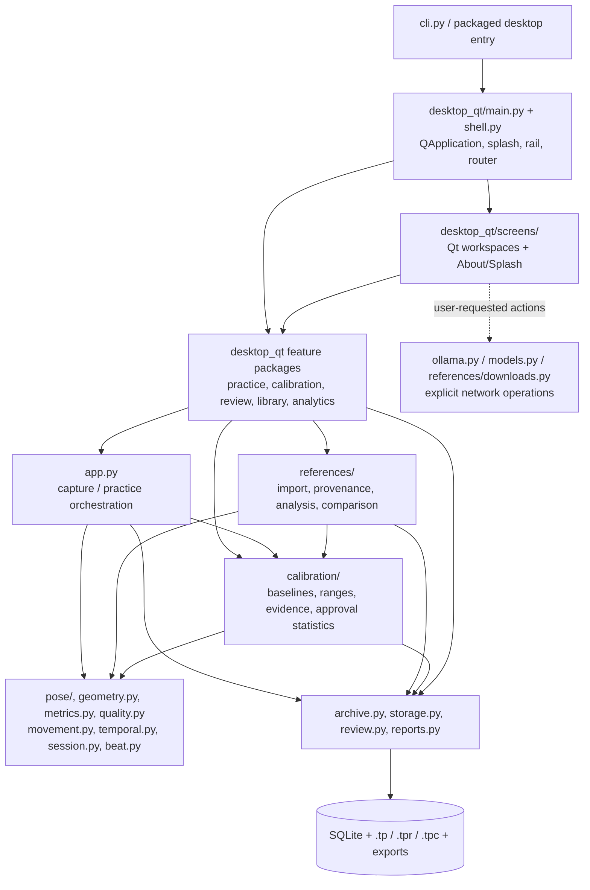
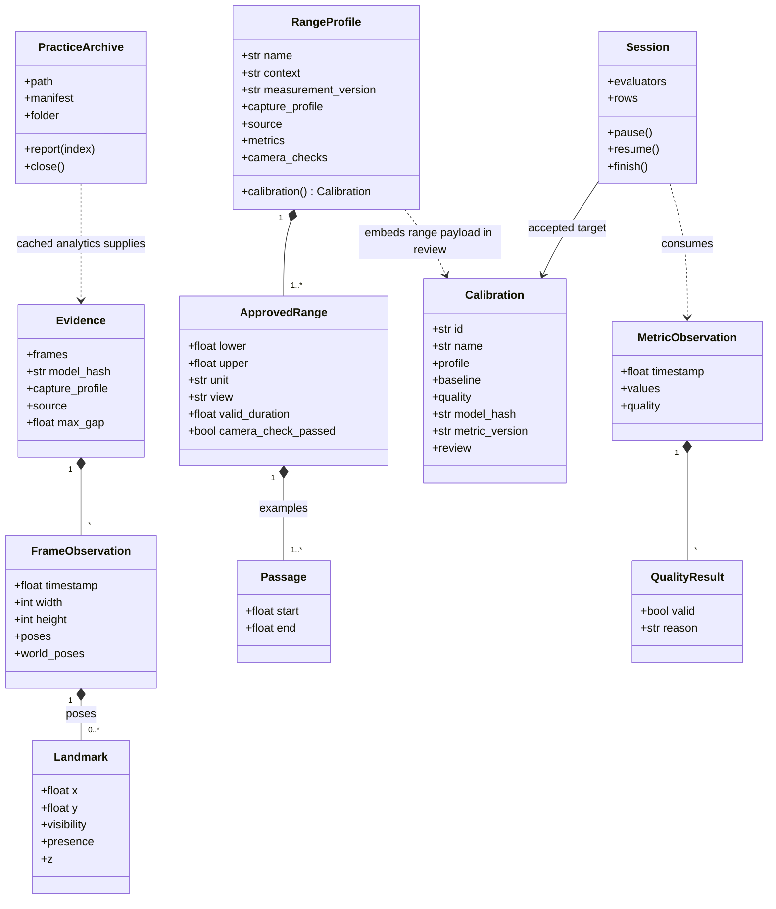
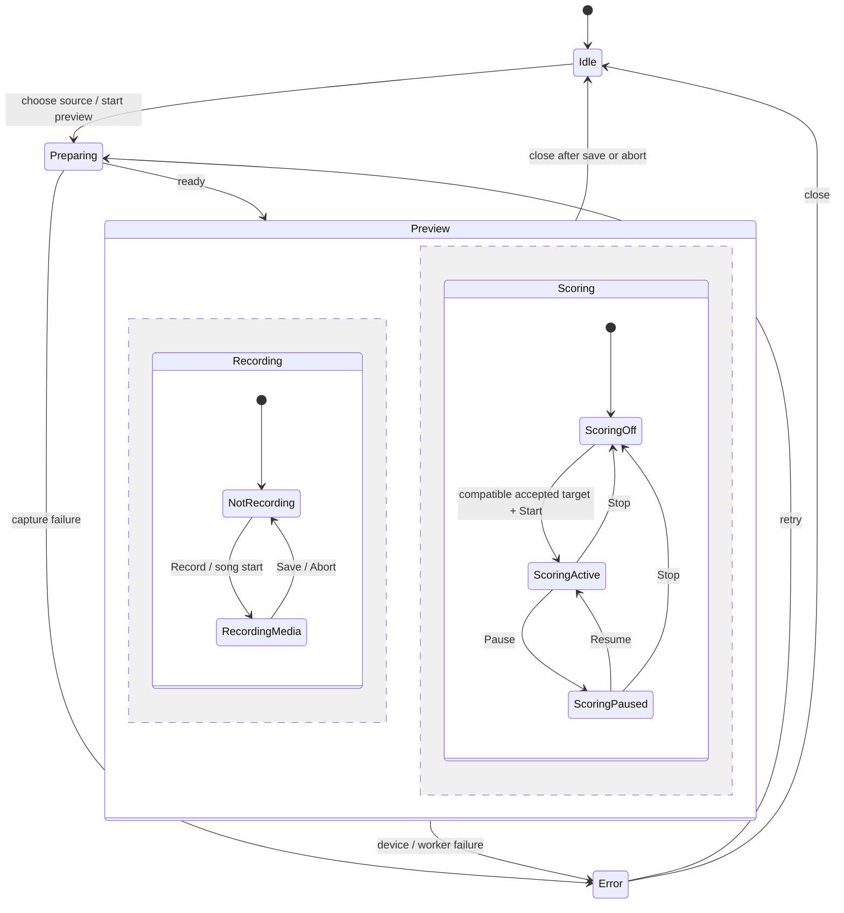
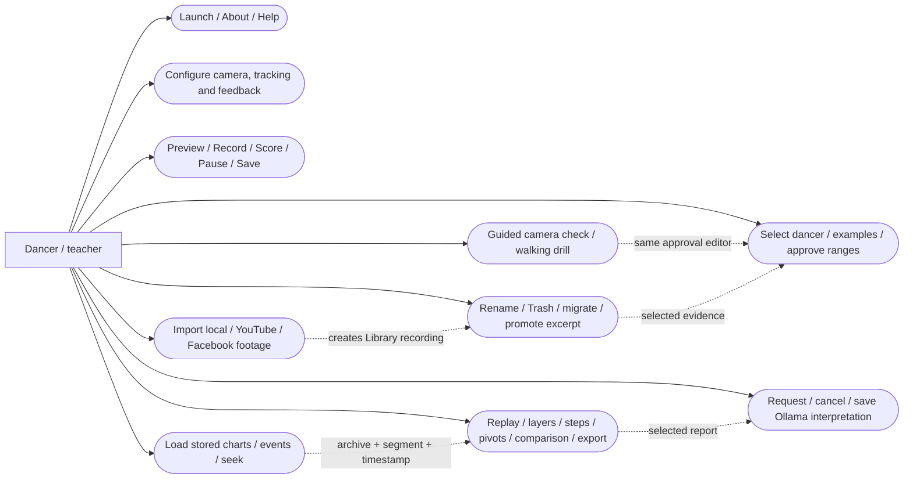
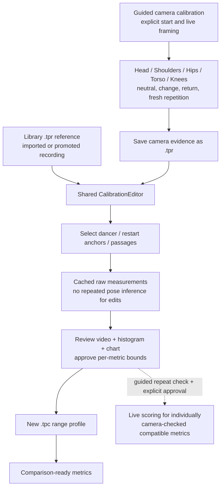
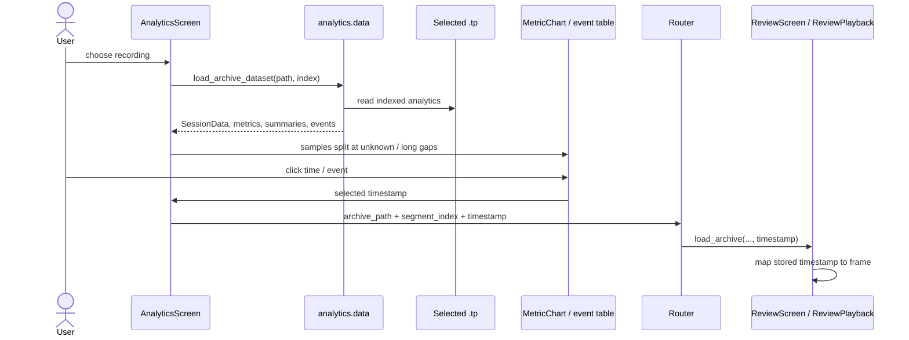

# TangoPosture: code, architecture and workflows

This is the developer guide to the **implemented Qt application**, not a proposal
for a replacement architecture. For installation, controls and measurement
mathematics, see the [user manual](TANGO_POSTURE_GUIDE.md). For acceptance limits,
see [manual validation](manual_validation.md).

Diagrams use Mermaid. GitHub renders the class, state and sequence diagrams;
VS Code needs a Mermaid-capable Markdown preview. Component and use-case views
use Mermaid flowcharts because Mermaid has no native UML component/use-case
syntax.

## Contents

1. [Architecture and dependency boundaries](#1-architecture-and-dependency-boundaries)
2. [Source map and relocation guide](#2-source-map-and-relocation-guide)
3. [Domain model and portable files](#3-domain-model-and-portable-files)
4. [Threads, state and resource ownership](#4-threads-state-and-resource-ownership)
5. [Use-case catalogue](#5-use-case-catalogue)
6. [Startup, About, Help and settings](#6-startup-about-help-and-settings)
7. [Practice, recording, scoring and songs](#7-practice-recording-scoring-and-songs)
8. [Library import and archive management](#8-library-import-and-archive-management)
9. [Reference and calibration workflows](#9-reference-and-calibration-workflows)
10. [Review, comparison and analytics](#10-review-comparison-and-analytics)
11. [Explicit Ollama interpretation](#11-explicit-ollama-interpretation)
12. [Maintenance and verification](#12-maintenance-and-verification)

## 1. Architecture and dependency boundaries

TangoPosture runs in one local Python process. Qt owns windows and navigation.
Capture, inference, analysis, persistence and optional HTTP requests are local
services called by screens or their workers. There is no mandatory server,
account, cloud inference or Tk implementation.



The diagram groups runtime collaboration; it is not an exhaustive Python import
graph. For example, calibration readiness consumes the reference video's probe
type, while the reference pipeline calls that readiness check.

### Boundaries to preserve

- **Views versus services:** screen layout and button handlers live in Qt;
  pose calculations, calibration statistics, archive formats and download logic
  do not import Qt.
- **Calibration versus references:** a reference is replayable evidence.
  A calibration is an approved interpretation of evidence for a particular view
  and practice context. A profile does not need its source video to score.
- **Measurement versus presentation:** raw landmarks supply measurements.
  Smoothed display landmarks supply overlays. Mirroring changes presentation,
  not the underlying measurement coordinate system.
- **Observation versus evaluation:** stored head/shoulder/hip/torso/knee values
  are not automatically calibrated scores. Approval, camera comparability,
  confidence, model identity and view checks control evaluation.
- **Archive versus database:** SQLite supports live sessions and export.
  Library replay and portable Analytics use the selected archive's evidence;
  they do not depend on the originating database.
- **Deterministic feedback versus AI:** `references/coach.py` builds numerical
  frame insights and overlays. It is not the Ollama client and makes no LLM
  requests.

The [core package](../src/tango_posture/core/) supplies pure desktop state and
other supporting models. [Contracts](../src/tango_posture/contracts/) define
typed records for the desktop specification. They are **not** a separate running
service or a universal RPC layer: the current application still uses
[domain records](../src/tango_posture/domain.py), direct Python calls, queues,
Qt signals and job-tagged worker events.

## 2. Source map and relocation guide

All paths below are relative to [the Python package](../src/tango_posture/).

```text
tango_posture/
  cli.py, desktop.py              CLI and packaged-app entry/configuration
  app.py                         Shared capture/practice orchestration
  config.py, domain.py            Validated configuration and shared records
  calibration/
    baseline.py                  Neutral-baseline capture and compatibility
    models.py                    Passage, ApprovedRange, RangeProfile, metric identities
    archives.py                  Version-2 .tpc profile serialization
    evidence.py                  Cached raw landmarks and conservative dancer tracking
    measurements.py              Confidence-qualified range measurements
    statistics.py                Passage summaries and guided repeat checks
    readiness.py                 Video/posture-analysis readiness checks
  references/
    archives.py                  .tpr creation and recording/excerpt promotion
    links.py                     YouTube/Facebook URL validation and source clocks
    downloads.py                 Cancellable yt-dlp adapters and download cache
    video.py                     Video probe, range validation and virtual decoding
    pipeline.py                  Reference clip-analysis orchestration
    coach.py                     Cached posture insights and frame overlay rendering
    coverage.py                  Measured evidence coverage by metric family
    soundtrack.py                Optional decoded soundtrack/beat analysis
    companions.py                Movement/coach JSON persistence and report lookups
    comparison.py                Content-checked relinking and anchored clip comparison
    results.py                   ImportedClipResult
    worker.py                    Cancellable import/download threads
    constants.py, errors.py       Shared import limits and cancellation exception
  desktop_qt/
    main.py, shell.py             Launch, navigation rail and window lifecycle
    router.py, service_bridge.py  Route payloads, configuration and catalogue access
    theme.py, navigation_icons.py Shared presentation
    screens/
      about.py, splash.py        About dialog and startup splash
      home.py, practice.py       Landing page and live practice workspace
      references.py, library.py  Calibration catalogue and portable-file library
      review.py, analytics.py    Replay/analysis workspaces
      coach.py, settings.py      Optional report interpretation and configuration
      help.py                    Rendered/searchable manual
    calibration/
      editor.py                  Shared evidence/range approval dialog
      guided.py                  Guided live-camera capture and repeat checks
    practice/worker.py           Qt worker, thread and capture-evidence mailbox
    review/
      analysis.py                Review-to-reference-analysis adapter
      playback.py                Owned readers, archives and timestamp mapping
    library/archives.py          Report packaging and legacy migration
    analytics/data.py            Read-only persisted-data projection
    components/                  Reusable controls, video stage, cards and MetricChart
  pose/                          MediaPipe adapter and named landmarks
  geometry.py, quality.py         Pure geometry, confidence gates and trackers
  metrics.py, temporal.py         Measurements and time-qualified feedback
  movement.py                    Steps, pivots, movement evidence and floor rendering
  capture.py, beat.py             Video input and audio/beat tracking
  session.py, storage.py          Session lifecycle, SQLite and exports
  archive.py                     Shared locked/atomic portable archive operations
  replay.py, review.py            Video IO, report metadata and saved AI analyses
  reports.py, overlay.py          Markdown reporting and shared drawing
  practice.py, display.py         Shared display/control adapters
  ollama.py                      Optional streaming HTTP client
  models.py                      Verified model manifest and explicit download
  tutorial_rendering.py          Shared Markdown/manual rendering
  core/, contracts/              Pure desktop state and supporting typed records
```

`__init__.py` files establish real Python packages. Most do not eagerly import
their submodules. The calibration package exposes the established baseline
functions through an explicit public API; implementation imports use the
specific owning modules.

### Old to new locations

| Previous location | Current owner |
| --- | --- |
| `calibration.py` | [calibration/baseline.py](../src/tango_posture/calibration/baseline.py) |
| `range_profiles.py` | [calibration/](../src/tango_posture/calibration/): models, archives, evidence, measurements, statistics |
| `reference_archives.py` | [references/archives.py](../src/tango_posture/references/archives.py) |
| `reference_import.py` | [references/](../src/tango_posture/references/) feature modules, plus [calibration/readiness.py](../src/tango_posture/calibration/readiness.py) |
| `desktop_qt/about.py`, `splash.py` | [screens/about.py](../src/tango_posture/desktop_qt/screens/about.py), [screens/splash.py](../src/tango_posture/desktop_qt/screens/splash.py) |
| `desktop_qt/calibration_editor.py`, `guided_calibration.py` | [calibration/editor.py](../src/tango_posture/desktop_qt/calibration/editor.py), [calibration/guided.py](../src/tango_posture/desktop_qt/calibration/guided.py) |
| `desktop_qt/practice_worker.py` | [practice/worker.py](../src/tango_posture/desktop_qt/practice/worker.py) |
| `desktop_qt/review_analysis.py`, `review_playback.py` | [review/analysis.py](../src/tango_posture/desktop_qt/review/analysis.py), [review/playback.py](../src/tango_posture/desktop_qt/review/playback.py) |
| `desktop_qt/library_archives.py` | [library/archives.py](../src/tango_posture/desktop_qt/library/archives.py) |
| `desktop_qt/analytics_data.py` | [analytics/data.py](../src/tango_posture/desktop_qt/analytics/data.py) |
| `MetricChart` inside the Analytics screen | [components/metric_chart.py](../src/tango_posture/desktop_qt/components/metric_chart.py) |

The old monolithic reference/range modules are removed, not retained as import
shims. External Python integrations must update those module paths. This does
not change the CLI entry points or serialized archive formats. The roughly
3,400-line reference importer is now divided by responsibility; the calibration
editor no longer imports a chart from another workspace screen.

Large but cohesive orchestrators, such as `Application` and `ReviewScreen`,
remain intact rather than being split into inheritance mixins solely to reduce
line counts.

## 3. Domain model and portable files

### UML class view

This view shows selected actual records and collaborations, not every field.



Definitions live in [domain.py](../src/tango_posture/domain.py),
[calibration/models.py](../src/tango_posture/calibration/models.py),
[calibration/evidence.py](../src/tango_posture/calibration/evidence.py),
[session.py](../src/tango_posture/session.py) and
[archive.py](../src/tango_posture/archive.py).

### File contracts

| File | Meaning | Persisted content and compatibility |
| --- | --- | --- |
| `.tp` | Practice session | Version-1 ZIP manifest; indexed recordings, reports, timestamps and analytics. Multiple recordings can append to the same named practice. |
| `.tpr` | Reference recording | Version-1 ZIP, kind `reference`, one recording, indexed replay assets/analytics, and `reference.json` with source/excerpt and optional dancer-selection details. |
| `.tpc`, version 2 | Approved calibration profile | Manifest plus `profile.json`; no recording segments. Contains ranges, units, applicable views/context, coverage, measurement/model identity, provenance and camera checks. |
| `.tpc`, version 1 | Legacy neutral baseline | Baseline calibration plus replay recording. Remains readable; explicit migration creates a separate `.tpr` without deleting it. |

An indexed practice/reference recording can contain:

```text
manifest.json
video_00.mp4
overlay_00.mp4
lines_00.mp4
report_00.md
report_00.metadata.json
analytics_00.json
```

Media/analytics members are optional where the original recording did not produce
them; the manifest is authoritative. Legacy companion/lines filenames are still
readable. Further recordings use `01`, `02`, etc. Movement data may also have an
indexed `movement_00.v1.json` companion. Saved Ollama analyses are separate
report-digest-bound JSON members, not numeric `analytics_00.json` replacements.

The shared archive layer validates members before temporary extraction, serializes
writers with per-path reentrant locks, and replaces completed temporary archives
atomically. On platforms with `fcntl`, it also attempts an advisory file lock;
this is not a universal cross-process transaction guarantee. Windows replacement
retries handle transient reader/scanner interference.

Calibration profile archives are written by
[calibration/archives.py](../src/tango_posture/calibration/archives.py), using the
same lock/replacement helpers. Existing profile names are rejected rather than
overwritten. A `RangeProfile` becomes a runtime `Calibration` through
`Calibration.review["range_profile"]`, preserving the existing SQLite schema.

Display-name edits change the manifest, not the physical filename.
Recording evidence and source hashes remain separate from mutable display names.

## 4. Threads, state and resource ownership

| Owner | Execution and communication | Cleanup / rejection of stale work |
| --- | --- | --- |
| `MainWindow`, screens, dialogs | Qt GUI thread; Router signals and route payloads | Navigating away stops Practice; window close waits for the active practice worker |
| `PracticeThread` / `QtPracticeWorker` | QThread runs `Application`; `QtPracticeDisplay` exposes frame/control/evidence mailboxes | Worker closes Storage in `finally`; capture loop releases devices, estimator, writers and audio |
| `ReferenceImportWorker` | Python thread, cancellation event, job-ID-tagged progress/result tuples | UI ignores mismatched job IDs; cancellation is cooperative; close requests cancellation and a bounded join |
| Library packaging/migration | Python thread, cancellation event and queue polled by Qt timer | Completed archive commits remain separate from staging; errors are displayed |
| Review analysis | Python thread, cancellation event and job-ID-tagged queue | Archive write verifies raw-video hash; stale UI jobs are ignored |
| Ollama | Python thread streams chunks through Qt signals with a request token | Cancelled/stale requests are not saved; HTTP timeout bounds blocked IO |
| `ReviewPlayback` | GUI timer drives local readers and owns extracted archive | Closing/replacing replay closes readers and temporary archive extraction |

Workers must not manipulate widgets. Live BGR frames are converted to copied
`QImage` values for display. Video capture favours fresh camera frames rather
than an accumulating backlog; file analysis uses ordered decoding. Guided
calibration explicitly requests raw observation capture.

### UML state view: desktop preview lifecycle

[core/session_state.py](../src/tango_posture/core/session_state.py) is immutable:
invalid commands raise `InvalidTransition` without changing the prior snapshot.
The Practice screen uses it to drive control availability, while `Application`
also maintains its own capture/scoring lifecycle.



Recording and scoring are independent controls: pausing scoring does not pause
the video. In the shared engine, Stop & Save finalizes the current recording and
its scoring session; the camera can remain open for another recording.
Abort concerns the current unsaved content, not already committed segments.

## 5. Use-case catalogue



| Use case | Main UI owner | Service modules / result |
| --- | --- | --- |
| Launch and navigate | `main`, `shell`, `router` | Validated Config; one QApplication and stacked workspaces |
| About / manual | `screens.about`, `screens.help` | Package metadata/logo; `tutorial_rendering` and bundled guide |
| Apply / reset / import / export settings | `screens.settings`, `service_bridge` | `config`; validated in-memory Config or TOML |
| Camera/file preview | `screens.practice`, `practice.worker` | `app`, `capture`, `pose`; frames and status |
| Record / score / pause / save / abort | `screens.practice`, `core.session_state` | `app`, `session`, `temporal`, `storage`, `archive`; `.tp` |
| Record successive songs | `screens.practice` | `app.update_auto_recording`, `beat`; indexed recordings |
| Local/online Library import | `screens.library` | `references.worker`, `pipeline`, `downloads`; `.tpr` or `.tp` |
| Rename / Trash / migrate | `screens.library`, `library.archives` | `archive`, `references.archives`; manifest edit or retained original |
| Promote recording/excerpt | `screens.library` | `references.archives.promote_reference`; separate `.tpr` |
| Reference-video calibration | `calibration.editor` | Shared calibration evidence/measurement/statistics services; `.tpc` |
| Guided capture / camera comparability | `calibration.guided` | Practice worker, repeat checks, reference promotion, shared editor |
| Inspect / match calibration | `screens.references`, `screens.library` | `service_bridge`, calibration loaders; explicit Config changes |
| Replay / seek / speed / frame step | `screens.review`, `review.playback` | `archive`, `replay`, `review`; source and archived timestamps |
| Analyze posture / movement / render floor | `screens.review`, `review.analysis` | Reference pipeline, shared movement/rendering; stored indexed analytics |
| Compare / export replay | `screens.review` | Second `ReviewPlayback`; `replay.save_overlay_video` |
| Charts / events / seek to video | `screens.analytics`, `analytics.data` | Archive-only projection and reusable `MetricChart`; Router payload |
| Interpret / cancel / reopen / export AI response | `screens.coach` | `ollama`, `review`, `archive`; report-digest-bound analysis |

## 6. Startup, About, Help and settings

### Launch and navigation

`tango-posture`, `tango-posture gui` and `tango-posture qt` all reach the Qt
launcher. The installed desktop entry also reaches Qt. CLI file-processing,
model setup, list and export commands remain available independently.

```mermaid
sequenceDiagram
    actor User
    participant CLI as cli.py / desktop.py
    participant Launch as desktop_qt.main
    participant Window as MainWindow
    participant Splash as screens.splash
    participant Router
    User->>CLI: launch desktop
    CLI->>Launch: launch_qt(validated Config)
    Launch->>Launch: create/reuse QApplication; load logo
    Launch->>Window: construct screens, bridge, navigation
    Launch->>Splash: show()
    Launch->>Launch: QTimer.singleShot(3000, finish_startup)
    Note over Launch,Splash: Qt event loop remains responsive
    Launch->>Window: show after timer
    Launch->>Splash: close()
    User->>Router: select destination
    Router->>Window: route_changed(route, payload)
    Window->>Window: switch workspace; refresh; deliver payload
```

About is a separate modeless dialog, reused by the shell. Help renders the same
Markdown manual used by the source documentation, with section navigation and
search; it is not an embedded external website.

Logo loading remains in the unchanged-depth launcher/shell and tries packaged
resources before the source-checkout logo directory. Moving the Splash/About
widgets does not change resource-relative lookup depth.

### Settings

[SettingsScreen](../src/tango_posture/desktop_qt/screens/settings.py) builds grouped
editors for the shared configuration. Apply collects all values and validates a
new `Config` before `ServiceBridge.update_config`. Validation failure leaves the
old configuration in place and reports the error in the status strip.

Reset publishes defaults. TOML export first applies valid editor values;
import validates TOML before replacing bridge configuration. Settings are not
silently written to a global file: TOML import/export provides persistence across
launches. Workers receive a run-specific configuration; changing settings does
not retroactively reinterpret a saved recording.

## 7. Practice, recording, scoring and songs

The UI owner is [PracticeScreen](../src/tango_posture/desktop_qt/screens/practice.py).
The execution adapter is [practice/worker.py](../src/tango_posture/desktop_qt/practice/worker.py);
the shared engine is [Application](../src/tango_posture/app.py).

```mermaid
sequenceDiagram
    actor User
    participant UI as PracticeScreen (GUI)
    participant Mail as QtPracticeDisplay
    participant Worker as PracticeThread / QtPracticeWorker
    participant App as Application
    participant Pose as Capture / PoseEstimator
    participant Session
    participant Store as Storage / archive.py
    User->>UI: Start Preview(source, optional calibration)
    UI->>Worker: start(run Config)
    Worker->>Store: open Storage; load selected target
    Worker->>App: run(display=Mail)
    loop captured frames
        App->>Pose: decode + estimate
        Pose-->>App: raw FrameObservation
        App->>App: quality, geometry, movement, beat and display overlay
        App->>Mail: latest frame, status, recording notifications
        UI->>Mail: drain on GUI timer
        opt scoring active
            App->>Session: process qualified measurements
            Session->>Store: observations / events
        end
    end
    User->>UI: Record / Start Scoring / Pause / Resume
    UI->>Mail: validated command / recording state
    App->>Mail: poll requests
    User->>UI: Stop & Save
    UI->>Mail: request save
    App->>App: close writers; finish recording/session
    App->>Store: export session; append indexed .tp recording
    App->>Mail: saved archive + segment notification
    User->>UI: Close Preview
    UI->>Mail: request quit
    App->>Pose: release capture and estimator
    Worker->>Store: close()
    Worker-->>UI: finished
```

### Preview and source selection

Preview accepts a camera or a file as an execution source. This does not bypass
Library's import/catalogue workflow: **Review's Open/Compare actions choose
Library archives**, while Practice's source chooses what its capture engine runs.
Preview alone does not require a scoring-ready calibration.

Loading a calibration adapts side/facing/resolution/capture settings from its
stored profile. The dancer still confirms the physical setup. Engine
compatibility checks reject mismatched model/metric identity or capture setup.

### Recording and scoring

Record starts media collection independently of scoring. Start Scoring requires
an accepted usable target. `Session` chooses the established neutral-baseline
evaluator or two-sided range evaluator; confidence, view, gap and persistence
rules remain explicit. Unknown intervals do not count as reassuring posture.

Pause/Resume affects scoring time and events, not recording. Save closes video
writers, optionally muxes supported microphone audio, finalizes reports and
appends a numbered recording. Abort is confirmed by the UI and discards current
unsaved work while preserving previously saved archive members.

Camera EOF/disconnect, worker exceptions, navigation and window-close paths
release resources and surface completion/failure. Leaving Practice requests a
safe stop rather than leaving a hidden camera running.

### Automatic song recordings

The checkbox sets the display's auto-recording event.
`Application.update_auto_recording` requires a live microphone stream and a
non-calibration run. Continuous detected music must exceed the configured start
delay; sustained silence must exceed the stop delay. Short gaps do not split
recordings. Each completed song appends another index, bounded by
`max_recordings`.

Disabling automation saves an active automatic recording. Tap tempo or a
synthetic clock is not evidence that a song is playing. Detector accuracy and
audio mux support remain platform/empirical concerns, not consequences of the
module reorganization.

## 8. Library import and archive management

### Import local video, YouTube or Facebook Reel

The entry point is [LibraryScreen](../src/tango_posture/desktop_qt/screens/library.py).
Import-as-reference defaults to `.tpr`; the alternative packages a `.tp`.
The original media is not edited in place.

```mermaid
sequenceDiagram
    actor User
    participant UI as LibraryScreen
    participant Worker as references.worker
    participant Pipeline as references.pipeline
    participant Download as references.downloads
    participant Video as references.video
    participant Engines as Pose / movement / frame insights
    participant Package as desktop_qt.library.archives
    participant Archive as archive.py / references.archives
    User->>UI: choose local file or online URL + clip range
    UI->>Worker: start(job, copied Config)
    Worker->>Pipeline: analyse_imported_clip(...)
    opt online source
        Pipeline->>Download: validate provenance; cancellable download
        Download-->>Pipeline: cached local media + source link
    end
    Pipeline->>Video: probe / validate range / decode
    loop selected frames
        Pipeline->>Engines: estimate, qualify and analyze
        Worker-->>UI: job-tagged progress
    end
    Pipeline-->>Worker: ImportedClipResult + report/companions
    Worker-->>UI: import_done(job, result)
    UI->>Package: background archive_report(...)
    Package->>Package: trim raw; render overlay and floor-lines; reindex evidence
    Package->>Archive: commit matched indexed assets + analytics
    opt import as reference
        Package->>Archive: mark_reference + reference.json
    end
    Package-->>UI: archive_done(job, path)
    UI->>UI: refresh Library; navigate to Review
```

Source validation lives in [links.py](../src/tango_posture/references/links.py);
download process/certificate/cancellation details live in
[downloads.py](../src/tango_posture/references/downloads.py).
Supported online actions require an explicit request, network access, appropriate
permission to use the footage and an available yt-dlp tool/module.

The current analysis range limit is 120 seconds and the source-size limit is
2 GiB. Probe/decode rejects invalid media/ranges before analysis.
[pipeline.py](../src/tango_posture/references/pipeline.py) coordinates existing
engines instead of duplicating their algorithms. It saves raw
`measurement_poses` separately from smoothed overlay `poses`.

Soundtrack decoding and beat analysis have a separate backend module, but Qt
Library currently invokes analysis with `analyse_soundtrack=False`; the existence
of that module does not imply a soundtrack-import control in the UI.

Cancel requests set analysis/download and packaging cancellation events. Jobs
stop at cooperative checkpoints; the UI waits rather than claiming immediate
termination. Job IDs prevent a late result from replacing a newer selection.

### Rename, delete and legacy migration

- **Rename:** validate a nonempty display name and atomically replace the
  manifest. Refresh shows the persisted name; the physical file is unchanged.
- **Delete:** after confirmation, move the selected file to Trash. This is not a
  recursive purge of practice/reference folders.
- **Migrate:** explicitly copy legacy report/video evidence into indexed practice
  archives, and copy legacy version-1 `.tpc` recordings into `.tpr`. Originals
  remain. Existing matching report/source hashes avoid duplicate migration;
  collisions and individual failures are reported.

### Promote a recording or excerpt

Library gathers the recording and optional start/end times, then calls
[promote_reference](../src/tango_posture/references/archives.py). The function
creates a separate `.tpr`, carries provenance, trims/reindexes available media and
cached evidence, and preserves the source `.tp`/legacy recording. Promoting does
not approve calibration ranges or make the excerpt automatically valid for live
scoring.

## 9. Reference and calibration workflows

### Shared workflow and boundaries



### Create a profile from a reference video

[CalibrationEditor](../src/tango_posture/desktop_qt/calibration/editor.py) loads
the recording through `PracticeArchive`, reads
[cached evidence](../src/tango_posture/calibration/evidence.py), and uses
[measurements](../src/tango_posture/calibration/measurements.py) and
[statistics](../src/tango_posture/calibration/statistics.py).

1. Validate cached dimensions, raw landmark availability, model identity,
   timestamps and tracking gap limit. Missing/display-only caches produce a
   message asking for Review reanalysis rather than invented measurements.
2. Select a numbered dancer. Conservative spatial association ends a track on
   gaps or ambiguity; it never silently switches to another person.
3. Add explicit restart anchors if needed and confirm that the linked passages
   follow the same dancer. Changing dancer evidence clears existing approvals.
4. Step through Head, Shoulders, Hips, Torso and Knees. Choose example passages
   independently of acceptable bounds. View median, p10/p90, usable duration,
   sample count, fraction inside the edited bounds, histogram and timestamp plot.
   Extrema/plot clicks seek the evidence video.
5. Approve or skip each metric. The middle 80% is a starting suggestion, not a
   statement of correct tango technique. Angular samples crossing the wrap
   boundary are handled consistently.
6. Save a distinctly named `.tpc`. Save rechecks the source archive hash,
   confirmed dancer identity and at least one approved metric.

Saving dancer selection separately updates `reference.json`; it does not rewrite
the raw measurements/video. An unapproved metric remains unavailable for scoring.
Per-leg support inference, pelvic rotation and validated 3-D spine diagnosis are
not supplied by this workflow.

### Guided camera calibration and a later camera check

[GuidedCalibration](../src/tango_posture/desktop_qt/calibration/guided.py) uses the
same practice worker in temporary session storage. The user explicitly starts the
camera and countdown; instructions are spoken and displayed.

For each wizard group, capture neutral, changed posture, return and a fresh
repetition. Each hold allows two seconds to settle followed by three seconds of
capture. Repeat checks operate per metric:

- all four holds must have at least 0.5 seconds and 60% reliable coverage;
- both observed changes must exceed twice the largest within-hold p90-p10 spread
  and move in the same direction;
- return-to-neutral must lie within the implemented noise/change tolerance.

Specific framing guidance and Retry/Skip remain available. A Solo walking context
adds an eight-second measured walking drill after settling. These are engineering
repeatability checks, not teacher validation of the target posture.

```mermaid
sequenceDiagram
    actor User
    participant Guided as GuidedCalibration
    participant Worker as QtPracticeWorker / Application
    participant Check as calibration.statistics
    participant Ref as references.archives
    participant Editor as CalibrationEditor
    participant Profile as calibration.archives
    User->>Guided: start camera; begin countdown
    Guided->>Worker: capture raw observations and recording
    loop wizard groups
        Guided->>User: speak/show neutral, change, return, repetition
        Worker-->>Guided: frames + timestamped raw observations
        Guided->>Check: repeat_check(samples, four holds)
        Check-->>Guided: per-metric outcome + reason
        User->>Guided: retry / skip / continue
    end
    opt Solo walking
        Guided->>Worker: retain walking-drill evidence
    end
    Guided->>Worker: request quit; save and release camera
    Guided->>Ref: promote saved evidence to .tpr
    Guided->>Editor: open reference + holds + optional existing target
    User->>Editor: choose examples, approve ranges and camera checks
    Editor->>Profile: save new .tpc
```

The same editor opens after video and camera capture. Live-alert enablement is
per-metric and explicit: the relevant repeat check must pass on camera evidence,
and the user must approve its camera-check flag. An existing video-derived
profile can be supplied as the target while camera evidence checks comparability.
Saving creates another profile rather than overwriting the original.

Video-derived unchecked ranges can be used for compatible-model comparison even
when the capture setup differs; they are not silently enabled for live scoring.
Live scoring requires compatible capture/model identity, an approved metric,
camera approval and a reliable applicable view.

### Inspect or apply a calibration

The References workspace lists calibration summaries, exposes details and offers
Match Camera Settings and New Calibration. Library additionally shows all three
portable file types and can open a version-2 profile's details or camera check.
Matching settings is explicit; it cannot establish that the real camera/dancer
has physically remained in the same place.

## 10. Review, comparison and analytics

### Open, replay and seek

[ReviewScreen](../src/tango_posture/desktop_qt/screens/review.py) selects archives
through `ServiceBridge.choose_library_archive`. Profiles without recording
segments are excluded. [ReviewPlayback](../src/tango_posture/desktop_qt/review/playback.py)
owns the `PracticeArchive`, extracted files and `VideoReader`.

Recording selection populates raw/overlay/available-lines variants. Play, pause,
frame step, speed and scrub controls operate on that reader. Stored frame
timestamps preserve pauses and timing gaps for seeking. A timestamp/frame-count
mismatch reports a warning and uses the video FPS timeline; timestamp-dependent
report navigation is rejected where it would be misleading.

The lower-level replay adapter retains local-video and legacy-report support for
service/tests and legacy flows. This does not add a standalone-video import
picker to the Qt Review workspace.

### Analyze posture and movement

```mermaid
sequenceDiagram
    actor User
    participant UI as ReviewScreen
    participant Job as Review analysis thread
    participant Adapter as review.analysis
    participant Pipeline as references.pipeline
    participant Archive as archive.store_analytics
    User->>UI: Analyze posture and movement
    UI->>Job: snapshot Config, archive, segment, raw video
    Job->>Job: hash raw video
    Job->>Adapter: analyse_review_clip(cancel, progress)
    Adapter->>Pipeline: analyse_imported_clip(...)
    Pipeline-->>Job: cached frame insights + movement evidence
    opt not cancelled and selected .tp / .tpr
        Job->>Archive: store indexed analytics(expected video hash)
        Archive->>Archive: verify current archived raw hash; atomic rewrite
    end
    Job-->>UI: job-tagged done/error/cancelled
    UI->>UI: render current frame and synchronized insights
```

Review uses the same deterministic posture/movement pipeline as imports.
Steps, pivots, projected axes, skeleton, head/shoulder/torso/hip metrics and knee
angles remain synchronized with the current frame. The floor-only mode renders
guide/lines/footprints rather than leaving the source video visible underneath.
Stored raw and overlay variants remain available.

Reanalysis is limited to the supported analysis duration and updates the matching
`analytics_XX.json`, not an unrelated recording's data. It does not turn raw
measurements into approved calibration coverage. Cancel/error status is explicit;
stale jobs cannot replace the current display.

### Comparison, report links and export

Open Comparison uses another Library recording, with a second owned
`ReviewPlayback`. It prefers the comparison raw stream and shows/hides a second
video stage; there is no comparison-stream combobox. Frames are synchronized by
elapsed playback time using each recording's timeline, not inferred semantic
alignment. The lower-level anchored comparison API lives in
[references/comparison.py](../src/tango_posture/references/comparison.py).

Timestamp links in the report seek the matching recording. Report-to-Coach
navigation passes the selected archive/recording rather than sending a request
automatically. Video export uses the selected replay/layers and existing local
video-writing helpers; errors are surfaced and original archive media is not
replaced.

### Portable Analytics and chart-to-video navigation

The Analytics workspace enumerates `.tp` recordings and calls
[load_archive_dataset](../src/tango_posture/desktop_qt/analytics/data.py).
It projects saved observations/events or stored frame measurements without
re-running inference and without opening the original database.



Null observations and excessive tracking gaps break chart lines. Valid/unknown
duration comes from persisted interval accounting, not sample counts; unavailable
values stay unknown. Frame measurements are labelled as measurements, not posture
scores. If no archived frame covers the selected time, navigation reports that
fact rather than guessing another recording.

## 11. Explicit Ollama interpretation

[CoachScreen](../src/tango_posture/desktop_qt/screens/coach.py) loads a saved report
or an archive recording. Loading a report does not call Ollama.
[OllamaClient](../src/tango_posture/ollama.py) is the HTTP boundary; it receives
report text, not video, and model output never executes application actions.

```mermaid
sequenceDiagram
    actor User
    participant UI as CoachScreen
    participant Job as Ollama thread
    participant HTTP as OllamaClient
    participant Server as Configured Ollama endpoint
    participant Report as review.py / archive.py
    User->>UI: select report and model; Analyze
    UI->>Job: token + cancel event + report digest
    Job->>HTTP: analyze(report Markdown, on_chunk, cancel)
    HTTP->>HTTP: validate endpoint and report size
    HTTP->>Server: explicit streaming /api/chat request
    loop streamed chunks
        Server-->>HTTP: text
        HTTP-->>UI: token-tagged chunk
    end
    Job->>Report: re-read report and verify digest
    alt cancelled or source report changed
        Job-->>UI: cancelled / stale; do not save
    else current nonempty response
        Job->>Report: save_analysis(text, model, endpoint, instruction, complete)
        Report->>Report: store companion in archive when applicable
        Job-->>UI: completed / length-limited result
    end
```

Saved interpretations contain the report SHA-256, model, endpoint, instruction,
timestamp, text and completion state. Reopening only associates matching-digest
responses. Export writes the selected analysis explicitly.

Connection/model checks are also explicit. The endpoint is configurable and can
be remote, so "local by default" is not a guarantee that every configured server
is on this machine. Cancellation is cooperative while streaming; a blocked HTTP
read can remain pending until its timeout.

Other network boundaries are the explicit model-setup download and online video
import. Camera/file practice does not automatically fetch a model or call an LLM.

## 12. Maintenance and verification

### Where to put a change

| Change | Start here |
| --- | --- |
| Splash/About appearance | [desktop_qt/screens/](../src/tango_posture/desktop_qt/screens/) |
| Range schema / metric identity | [calibration/models.py](../src/tango_posture/calibration/models.py) |
| Measurement / reliability rule | [calibration/measurements.py](../src/tango_posture/calibration/measurements.py), shared geometry/quality/metrics |
| Evidence association / passage statistics | [calibration/evidence.py](../src/tango_posture/calibration/evidence.py), [statistics.py](../src/tango_posture/calibration/statistics.py) |
| Wizard controls / guidance | [desktop_qt/calibration/](../src/tango_posture/desktop_qt/calibration/) |
| URL / download / decoding issue | Corresponding [references/](../src/tango_posture/references/) module, not a screen |
| Reference-analysis coordination | [references/pipeline.py](../src/tango_posture/references/pipeline.py) |
| Shared archive mutation | [archive.py](../src/tango_posture/archive.py); retain locks, hash checks and atomic replacement |
| Library packaging / migration | [desktop_qt/library/archives.py](../src/tango_posture/desktop_qt/library/archives.py) |
| Replay resource/timeline handling | [desktop_qt/review/playback.py](../src/tango_posture/desktop_qt/review/playback.py) |
| Stored analytics / reusable charts | [desktop_qt/analytics/data.py](../src/tango_posture/desktop_qt/analytics/data.py), [components/metric_chart.py](../src/tango_posture/desktop_qt/components/metric_chart.py) |
| Ollama protocol / prompt | [ollama.py](../src/tango_posture/ollama.py); lifecycle stays with the Coach workspace |

Keep UI imports out of shared services. Import the owning module, not an
unrelated screen or a removed monolith. When moving a function, update production
imports, tests and module-qualified monkeypatch targets together. Do not introduce
another worker pipeline when an existing engine or adapter can supply it.

No dependency or archive-schema change is required by this reorganization.
Hatch packages the new subpackages; PyInstaller follows their normal imports.
Existing resource lookups, console entry points and no-Tk exclusions remain.
The root `/references/` and `/practice/` ignore rules concern user media, not
similarly named Python source packages.

### Automated checks

From the repository root, run uv commands serially:

```bash
uv run --frozen ruff check .
uv run --frozen mypy src
QT_QPA_PLATFORM=offscreen uv run --frozen pytest -q
git diff --check
```

The reorganized source passes **337 tests**, Ruff and mypy across **96 source
files**. Existing tests use canonical imports/patch targets without changes to
their behavioral assertions. Coverage includes URL/download adapters,
range statistics, archives, live session integration, calibration dialogs,
playback, Library, Analytics, Coach and desktop entry points.

Additional reorganization checks verified unchanged syntax trees for 133 relocated
functions/classes/constants apart from imports, all 75 links in this guide,
byte-for-byte inclusion of every Python source file in the wheel, imports of
all 95 packaged submodules without Tk, and actual offscreen startup through the
three-second splash, nine workspaces and About dialog.

These are software checks, not real-dancer acceptance. Real camera/microphone
behavior, long sessions, native accessibility/scaling, clean macOS/Windows
installers, teacher judgement and cross-camera measurement validity still require
the [manual protocol](manual_validation.md). In particular, repeatability is not
biomechanical validity, projected metrics are view-dependent, and playback
comparison is not temporal/technique alignment.
