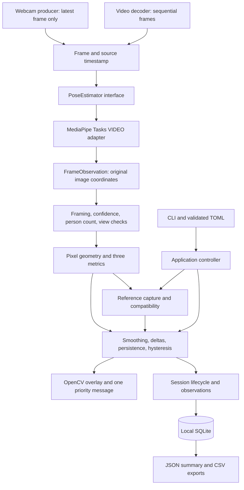
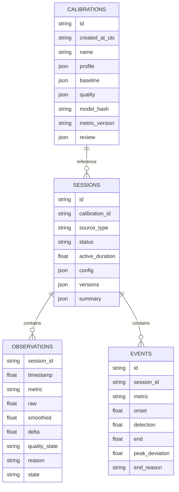
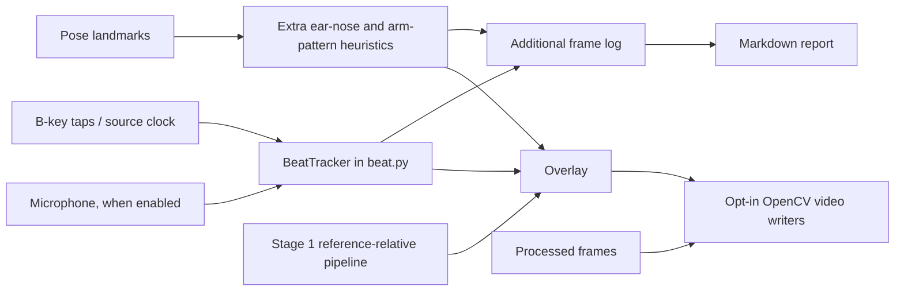

# Tango Posture Coach Manual

**Stage 1 · application version 0.1.0 · 1 November 2026**

Tango Posture Coach is a local practice companion for observing how your head and trunk alignment changes relative to a reference position you deliberately record. It uses a computer webcam or an existing video file, estimates a small set of body landmarks, and reports sustained changes in three image-based measurements.

The intended setting is **individual Argentine tango practice: one dancer, a fixed camera, and a side-on view during standing and simple solo walking**. The application gives you something specific to observe and discuss with a teacher. It does not decide what tango technique should look like, and it cannot replace a teacher's interpretation of movement.

**Scope note:** the main guide describes the reference-based Stage 1 pipeline. Additional features appeared in the workspace during documentation: beat tracking, recording, Markdown reports, and extra head/arm heuristics. [Section 23](#23-additional-features-in-the-current-workspace) describes their actual behaviour and limitations; they do not inherit validation from the three core metrics.

This manual combines the dancer's practice guide, reference and report comparison workflow, configuration explanations, and technical limits. It describes the current workspace; where experimental extensions exceed the original Stage 1 scope, that boundary is called out explicitly.

## Contents

1. [The practice question the tool addresses](#1-the-practice-question-the-tool-addresses)
2. [What Stage 1 supports](#2-what-stage-1-supports)
3. [What it measures—and the limits of those measurements](#3-what-it-measuresand-the-limits-of-those-measurements)
4. [A first practice session](#4-a-first-practice-session)
5. [Choosing and calibrating a reference](#5-choosing-and-calibrating-a-reference)
6. [Understanding the screen and feedback](#6-understanding-the-screen-and-feedback)
7. [Why the application sometimes cannot assess](#7-why-the-application-sometimes-cannot-assess)
8. [Analysing recorded practice](#8-analysing-recorded-practice)
9. [Reading a session summary](#9-reading-a-session-summary)
10. [The overall architecture](#10-the-overall-architecture)
11. [Technologies and why they are used](#11-technologies-and-why-they-are-used)
12. [Components and responsibilities](#12-components-and-responsibilities)
13. [The measurement mathematics](#13-the-measurement-mathematics)
14. [Time, smoothing, and persistent events](#14-time-smoothing-and-persistent-events)
15. [Configuration and reference compatibility](#15-configuration-and-reference-compatibility)
16. [Storage, exports, and privacy](#16-storage-exports-and-privacy)
17. [Offline operation and the model licence](#17-offline-operation-and-the-model-licence)
18. [Testing and validation](#18-testing-and-validation)
19. [Troubleshooting](#19-troubleshooting)
20. [Extending the application](#20-extending-the-application)
21. [A practical review worksheet](#21-a-practical-review-worksheet)
22. [Glossary and further reading](#22-glossary-and-further-reading)
23. [Additional features in the current workspace](#23-additional-features-in-the-current-workspace)
24. [Settings explained](#settings-explained)
25. [One-reference comparison workflow](#one-reference-comparison-workflow)

## 1. The practice question the tool addresses

A useful practice question is: **“During this exercise, does the alignment I can observe from this camera remain close to the reference I chose?”**

That is narrower than asking whether a dancer has good posture. A teacher may ask you to explore a particular organisation of the head and trunk for a particular exercise. You can record that intended position, practise while remaining in the same camera view, and investigate when the image-based measurements drift away from it.

For example, you might record a reference stance, then perform a simple solo walk while maintaining the same side-on orientation. If the selected ear moves persistently farther forward relative to the selected shoulder and trunk, the tool can display “Head farther forward than reference.” You can then decide whether that observation is relevant to the exercise, ideally with your teacher's input.

The tool does not know your intention, your sensation, or the movement's meaning in a dance. A change may be intentional. A stable measurement may coexist with something important that this camera cannot see. Feedback is therefore an observation to investigate, not an instruction to force your body into a particular shape.

The reference-based design matters: **there is no universal ideal position encoded in the application**. Different references can be appropriate for different practice questions. The thresholds describe changes from a selected reference, not distance from an assumed ideal dancer.

## 2. What Stage 1 supports

| Supported practice setting | Conditions |
| --- | --- |
| Standing in a reference position | One person, selected anatomical side visible, full body adequately framed |
| Simple solo walking | Remain side-on and keep the selected facing direction |
| Webcam observation | Fixed camera, native desktop window, explicit session controls |
| Existing local video | Sequential analysis with source timestamps |
| Comparing sessions | Compatible reference and capture setup; inspect coverage as well as events |
| Teacher discussion | Use exported measurements alongside independently reviewed practice |

Stage 1 deliberately excludes couples, embrace assessment, turns, ochos, pivots, and choreography classification. It does not support frontal-view scoring or tracking multiple dancers. It does not download online videos, train a custom model, provide voice coaching, or host a dashboard.

Some movement may remain visible to the pose model while being outside the supported exercise. A detected skeleton alone does not establish that the application can interpret that movement. In particular, a complete turn cannot be reliably identified or evaluated from these few monocular measurements.

## 3. What it measures—and the limits of those measurements

The three measurements use the selected-side **ear, shoulder, and hip**. Additional landmarks help assess framing and whether the view is sufficiently side-on.

| Measurement | In everyday terms | Unit | A potentially reportable deviation |
| --- | --- | --- | --- |
| Head-forward offset | How far the ear lies toward the selected front, relative to the shoulder and trunk | Projected torso lengths | A positive increase from reference |
| Head segment inclination | The angle of the shoulder-to-ear segment relative to the trunk | Degrees | A change in either direction from reference |
| Trunk inclination | The angle of the hip-to-shoulder segment relative to image vertical | Degrees | A change in either direction from reference |

### Head-forward offset

This measurement asks whether the selected ear is farther forward relative to the selected shoulder and the trunk's orientation. It divides the projected displacement by projected torso length so the result is a ratio, not a distance in centimetres.

A delta of `+0.10` means a change of one tenth of the projected torso length along the defined forward direction. It does **not** mean that the head moved ten centimetres. The ratio remains an image-plane measurement and does not eliminate perspective or camera-view problems.

Only positive increases trigger the head-forward event. A backward change can still appear in the observations and summary, but this metric does not generate a symmetric backward-deviation event.

### Head segment inclination

This is the angle of the line from shoulder to ear relative to the trunk. It is a convenient posture proxy because both endpoints can be estimated by the pose model.

It is not an anatomical neck-flexion angle. It is not a measurement of facial pitch, and it cannot establish where your eyes are directed or prove that you are looking at the floor. The appropriate interpretation is simply that the visible ear–shoulder relationship differs from the reference.

### Trunk inclination

This measurement compares the hip-to-shoulder segment with vertical in the image. Camera roll matters: if the camera is tilted, image vertical is not an independently measured gravitational vertical.

The app does not reconstruct the spine. A line between hip and shoulder is not a measurement of spinal curvature, and it does not establish balance, weight distribution, or dance quality.

### Why there is no combined score

The head-forward offset and head segment inclination are related: both depend on the same ear–shoulder vector. Adding them into a score would risk counting related observations twice and would conceal their different meanings.

The application therefore reports the measurements separately. It also keeps measurement coverage separate from deviation time. A session with many unknown frames must not appear successful simply because few events could be confirmed.

## 4. A first practice session

### Install the environment and model

The initial compatibility target is Python 3.11. The implementation was checked on macOS on Apple Silicon. From the repository root:

```bash
uv python install 3.11
uv sync --frozen
uv run tango-posture models fetch
uv run tango-posture --help
```

`uv sync --frozen` installs the dependency versions recorded in the lockfile. `models fetch` performs the explicit model download and checksum verification. After these setup steps, ordinary runs do not require a network connection.

### Set up the camera

Use a fixed, approximately level camera and leave enough space in the frame for the whole body. Choose adequate lighting and an uncluttered background. Fitted clothing may make landmark estimation easier, but the application must abstain if visibility is inadequate regardless of clothing.

Select both the anatomical side visible to the camera and the direction you face in the original image:

```bash
uv run tango-posture run --camera 0 --side left --facing right
```

Here, `left` means your left anatomical side is the selected visible side. `right` means you face toward the right-hand side of the **unmirrored** image. These are separate choices.

Camera device indices are explicit. The application does not silently switch to a different device if camera 0 is unavailable.

### Record the reference and start

In **References**, name your reference and click **Open calibration camera**. Press C after preparing to adopt your intended reference. There is a three-second countdown, followed by the configured capture interval (twelve seconds by default). A valid capture saves `calibrations/<name>.tpc` with its raw video, annotated overlay, and `reference.json`. Press C to capture again: a successful calibration replaces the same archive rather than appending recordings. A failed capture leaves the previous valid archive intact. Q closes the calibration camera.

The saved `.tpc` is selected for the next coach run. Confirm physical camera placement before reuse; the coach loads the reference JSON directly from the archive. Press S to begin reference-based scoring and session statistics; it does not start video recording. Press R (Record) to start video recording. E stops and saves recording and scoring while leaving the preview open; Q saves and quits. Press R again after E to add the next numbered recording to the same practice archive.

During practice, P pauses or resumes. E ends and saves the session. Q quits and saves an unfinished session with an explicit stopped status. Ctrl+C and closing the window also stop the run cleanly through the application lifecycle.

**Abort / exit (X)** asks for confirmation, then closes the coach without saving the current recording, overlay, report, or scoring session. Previously saved practice segments are preserved. Abort does not display a saved-file notification.

The coach's **Automatically record songs** checkbox starts a recording after sustained live-microphone music detection, then stops and saves it after sustained detected silence. Subsequent songs append more numbered video/overlay/report segments while the checkbox stays checked. Unchecking it saves an active automatic recording and disables further automatic starts. It requires camera mode, enabled beat tracking, and a working microphone; clock and tap-tempo fallbacks cannot trigger it.

Use **Parameters > Music recording parameters** in the coach or **Settings > Music** in the studio to set the start delay, stop delay, and maximum recordings. Settings changes apply to the next coach run. Short pauses below the stop delay do not split the recording, and manual stopping does not restart recording in the middle of the same detected song. The limit counts manual and automatic recording starts in that run, not old segments already in the archive.

With the current workspace beat-tracking extension enabled, a GUI webcam run also attempts to open the microphone. To run without that input, set `beat_tracking = false` in your TOML file; see Section 23.

The default workflow is best understood as separate phases: setup, deliberate reference selection, practice, and review. Previewing yourself before a usable reference is accepted does not start an evaluation.

### Display mirroring

If you prefer a mirrored display, add `--mirror`. Setup remains unmirrored so the facing-direction choice is clear. V confirms setup and enables the requested mirror; C or S also confirms setup.

Mirroring only transforms rendered pixels and overlay coordinates. It never changes the pose coordinates used for calculations or the measurements saved to storage.

## 5. Choosing and calibrating a reference

A reference is a saved description of the measurements observed during a deliberately selected stable interval. It is not a pretrained ideal pose or an automatically chosen teacher judgement.

By default, references are labelled **self-selected**. To record an explicit teacher review statement:

```bash
uv run tango-posture run --camera 0 --side left --facing right \
  --reference-name 'Solo walk reference' \
  --teacher-reviewed 'Reference reviewed for this exercise'
```

The review note is user-provided metadata. The software has no way to verify the review or infer it from the image.

### What calibration checks

Within the twelve-second capture window, the default requirements are:

- At least nine seconds of valid observations, measured using timestamps.
- At least sixty valid samples.
- All three metric quality checks pass for accepted samples.
- Median absolute deviation is at most `0.03` torso lengths for offset and `4°` for each angle.

A high sample count alone is insufficient. Sixty frames collected over a very short interval cannot substitute for the required valid duration. Likewise, a long recording with unreliable landmarks does not become a valid reference just because time passed.

The baseline for each metric is the median of the accepted measurements. The reference also retains dispersion, coverage, sample count, expected view-width range, image dimensions, anatomical side, facing direction, capture profile, model checksum, metric version, and review metadata.

### Why stability and coverage are different

Stability describes how much accepted measurements vary. Coverage describes how much of the capture window supplies acceptable evidence. A person can remain still while the model sees too little to measure reliably; such a capture may be stable in the few available samples but still fail coverage.

These checks are engineering safeguards, not proof of suitability for tango. A stable and well-observed reference can still be inappropriate for your intended exercise.

### Reusing a reference

List references with:

```bash
uv run tango-posture calibrations list
```

When reusing one, the application checks stored metadata and requires confirmation that physical camera placement has not changed. The confirmation is necessary because a camera can move while retaining exactly the same resolution and device index.

Recalibration is recommended at every new setup. Do not interpret metadata compatibility as evidence that the physical view is unchanged.

## 6. Understanding the screen and feedback

There are two distinct kinds of state: **application state** and **measurement state**.

| Application state | Meaning |
| --- | --- |
| READY | Previewing or ready to begin; no active practice session |
| CALIBRATING | Countdown or reference capture |
| RUNNING | Session observations are evaluated and recorded |
| PAUSED | Practice time and evaluation are suspended |
| FINISHED | Session saved; the summary is available |

| Measurement state | Meaning |
| --- | --- |
| WITHIN_REFERENCE | No sustained deviation is active under the configured rules |
| PENDING | Entry threshold exceeded, but persistence time not yet satisfied |
| DEVIATION | A persistent event has been confirmed |
| UNKNOWN | There is insufficient evidence for this metric |

“Within reference” does not mean medically or technically correct. “Unknown” does not mean within reference.

During a running session, the overlay shows active elapsed time, processed FPS, selected side and facing direction, reference identity, current smoothed metric values, reference deltas, and measurement states. The core Stage 1 feedback policy limits prominent feedback to one message at a time:

1. A quality or view problem takes priority.
2. Otherwise, an active head-forward deviation is shown first.
3. Next comes head inclination.
4. Then trunk inclination.

The current workspace also has an independent head-angle warning that can take priority over these messages; it does not use the same gates or reference logic. See Section 23 before treating that warning as an assessed Stage 1 deviation.

All metric events are still logged even when another message has display priority. This prevents the screen from becoming a list of simultaneous coaching prompts while preserving the underlying observations for review.

## 7. Why the application sometimes cannot assess

Abstention is part of the measurement design. It means the current image does not support the requested observation with the configured safeguards.

### Person count

MediaPipe is configured to detect up to two poses. If it returns zero or more than one, the application suspends evaluation. With two detected poses, the prominent message is “One-person mode only.”

The guard cannot guarantee that every person in the background will be detected. It is not multiple-person tracking or couple support.

### Landmark reliability

Required landmarks must have finite coordinates, be within the image, and meet visibility and presence thresholds. The default minimum is `0.70` for both confidence values. Missing confidence is not silently replaced with a perfect score.

If the selected ear is unreliable, the head metrics become unknown. The trunk metric may remain available if the overall view and its required landmarks remain valid.

### Framing and segment sizes

The nose and at least one confidently visible ankle must be in frame. The far ankle may be occluded, so both ankles are not required.

The projected torso must be at least 12% of image height. The shoulder-to-ear segment must be at least 4%. Zero-length and nonfinite geometry is invalid. These checks avoid calculating apparently precise angles from unusably small or degenerate segments.

### Side-on view evidence

When both shoulders and hips are reliable, the application compares projected shoulder and hip widths with torso length. The default rule is:

```text
max(projected shoulder width, projected hip width) / torso length <= 0.45
```

This is an adjustable heuristic, not a dependable orientation classifier. If the required pair landmarks are unreliable, view quality is unknown and evaluation abstains. Calibration also records an expected width range to help detect obvious changes in view.

A significant practical limitation is that the far shoulder or hip may be difficult to estimate in a real side-on image. The resulting coverage must be measured during validation. Relaxing the gate just to obtain more feedback can trade away the evidence the feedback depends on.

## 8. Analysing recorded practice

Video-file mode provides a repeatable way to develop and investigate the pipeline without a webcam. It uses the same pose adapter, quality checks, geometry, calibration, temporal rules, and storage as live observation.

To explicitly select the first twelve seconds as a reference interval and analyse the following movement:

```bash
uv run tango-posture run --video ./practice.mp4 \
  --side left --facing right \
  --reference-interval 0 12 \
  --reference-name 'Video practice reference' \
  --headless
```

The interval must match the configured calibration duration. In headless mode, supplying it is an explicit choice to accept the reference if its checks pass. A rejected calibration stops the run with an explanation; there is no hidden prompt.

The reference interval and preceding preview time are excluded from practice statistics. A later interval, such as `5 17`, therefore starts practice after that interval, not at the start of the file.

To reuse a saved compatible reference:

```bash
uv run tango-posture run --video ./practice.mp4 \
  --calibration REF_ID --confirm-camera-unchanged --headless
```

Replace `REF_ID` with the UUID printed when the reference was accepted or shown by `calibrations list`.

Omit `--headless` for the native OpenCV window. GUI file analysis runs at processing speed rather than real-time playback. Source timestamps, rather than wall-clock playback speed, still govern smoothing and persistence.

A standalone inference report is also available:

```bash
uv run python scripts/smoke_video.py ./practice.mp4 \
  --side left --facing right \
  --output ./data/real-video-smoke.json
```

This script reports quality coverage and runtime measurements without requiring successful reference calibration. It does not generate reference-relative coaching events and does not save video frames.

## 9. Reading a session summary

The application automatically saves each ended session and prints its export location. You can also list and export stored sessions:

```bash
uv run tango-posture sessions list
uv run tango-posture sessions export SESSION_ID --output ./exports
```

For each metric, the summary includes:

| Field | Interpretation |
| --- | --- |
| Valid duration | Active time supported by acceptable consecutive observations |
| Unknown duration | Active time not supported by those observations |
| Valid coverage | Valid duration divided by active duration |
| Time above entry | Valid time above that metric's entry threshold |
| Confirmed-event duration | Time belonging to persistent events, restricted to valid intervals |
| Event count and longest event | Number and length of confirmed episodes |
| Median delta | Median of available sampled deltas |
| Peak absolute delta | Largest observed magnitude of change |
| Peak positive delta | Additional forward-only peak for head-forward offset |
| Percentage denominator | Valid seconds used to calculate event percentages |

Consider a hypothetical sixty-second active session. Suppose a metric has forty-five valid seconds, fifteen unknown seconds, and nine seconds within confirmed events. The confirmed-event percentage is `9 / 45 = 20% of valid time`. Coverage is `45 / 60 = 75%`. Both figures matter.

A zero-valid-data session has no meaningful percentage: the JSON uses null, and the displayed percentage is N/A. Missing CSV values are blank, never manufactured zeros.

Events for different metrics can overlap. Do not add head-forward, head-inclination, and trunk-inclination durations and describe the result as unique session time.

### Onset versus detection

An event has an onset timestamp and a detection timestamp. Onset is the first threshold-exceeding observation in the qualifying continuous run. Detection is when enough persistence has elapsed to confirm the event.

That distinction lets you review when a deviation began without pretending that the application could have confirmed it immediately.

## 10. The overall architecture

The architecture separates input and display from the mathematical and temporal pipeline. This separation makes the core behaviour testable with synthetic landmarks and allows webcam and video-file runs to share the same logic.



The learned component is MediaPipe's landmark estimator. The remaining decisions—quality gates, geometry, reference statistics, temporal rules, and summary accounting—are explicit application code.

There is no language model in the runtime. The phrase “AI agent” in the implementation specification describes the agent implementing the application; it does not mean the shipped tool contains a conversational agent, autonomous coach, or cloud service.

## 11. Technologies and why they are used

| Technology | Responsibility | Important boundary |
| --- | --- | --- |
| Python 3.11 | Application language and standard-library services | Initial tested compatibility target |
| uv and `uv.lock` | Dependency resolution and repeatable installation | Network may be needed during setup |
| MediaPipe Tasks Pose Landmarker | Estimate body landmarks from RGB images | Local inference; image-based estimates remain uncertain |
| OpenCV | Camera/file capture, colour conversion, drawing, desktop display | No web server or browser required |
| NumPy | Vector geometry, medians, dispersion, runtime percentiles | No physical calibration inferred from pixel values |
| Pydantic | Typed configuration and validation | Rejects invalid values and inconsistent thresholds |
| `tomllib` | Parse TOML configuration | Python standard library |
| `argparse` | Command-line interface | Explicit sources, reference choices, and setup commands |
| `sqlite3` | Local transactional storage | No cloud database |
| `threading`, queues, and a single worker | Fresh webcam frames and responsive GUI quit | No concurrent inference calls on the same detector |
| pytest | Behavioural and integration tests | Synthetic tests do not establish dancer accuracy |
| Ruff | Code linting and formatting | Static quality checks |
| mypy | Static type checking | Complements runtime and behavioural tests |
| Hatchling | Build the package and CLI distribution | Setup/build tooling |

The initial implementation does not need pandas, SciPy, a web framework, or a separately installed deep-learning framework. MediaPipe supplies the local inference runtime required by the selected model.

The specific selected versions are recorded in [pyproject.toml](../pyproject.toml) and [uv.lock](../uv.lock). MediaPipe is pinned to 0.10.30 because the newer inspected releases introduced an `opencv-contrib-python` dependency that would overlap the requested `opencv-python` installation.

## 12. Components and responsibilities

### Entry, configuration, and shared records

| Module | Responsibility |
| --- | --- |
| `cli.py` | Parse commands, merge overrides, enforce reference/setup requirements, report actionable errors |
| `config.py` | Define validated configuration, threshold relationships, confidence bounds, durations, and TOML loading |
| `domain.py` | Define records and the `PoseEstimator` protocol shared across layers |

The shared records include `Landmark`, `FrameObservation`, `QualityResult`, `MetricObservation`, `Calibration`, `DeviationEvent`, and `SessionSummary`. Keeping these records independent of camera and window APIs reduces coupling between measurement logic and infrastructure.

### Capture and pose estimation

| Module | Responsibility |
| --- | --- |
| `capture.py` | Decode files sequentially or collect the latest webcam frame; establish source timestamps and record fallback/drops |
| `pose/mediapipe_backend.py` | Verify the model, create the Tasks detector, convert BGR to RGB, adapt landmark output |
| `pose/constants.py` | Central named landmark-index mapping and skeleton connections |
| `models.py` | Load the model manifest, verify SHA-256, perform the explicit setup fetch |

The `PoseEstimator` protocol provides a small replacement point. Tests can inject known landmark observations without invoking the real model. An alternative local pose backend would need to produce equivalent named landmarks and preserve the confidence semantics.

Both input modes use MediaPipe VIDEO mode. Source timestamps remain separate from MediaPipe's strictly increasing integer-millisecond inference timestamps. If two source frames round to the same millisecond, the adapter advances the inference timestamp without rewriting the source timeline used by statistics.

For webcams, a producer thread holds at most one queued frame. When newer frames arrive, stale ones are discarded. This favours freshness over building a delayed backlog. File mode instead processes every decodable frame in order for reproducibility.

### Measurement and reference

| Module | Responsibility |
| --- | --- |
| `quality.py` | Determine whether an individual landmark is finite, in bounds, and sufficiently confident |
| `geometry.py` | Pixel conversion, wrapped angles, and the pure metric formulas |
| `metrics.py` | Apply overall and per-metric gates before calculating available values |
| `calibration.py` | Validate reference coverage/stability, calculate baselines, save capture identity, check compatibility |

These modules do not open a camera or display a GUI. Their inputs can be hand-authored landmark records, which is central to testing non-square images, sign conventions, missing data, and geometric invariance.

### Feedback, lifecycle, and output

| Module | Responsibility |
| --- | --- |
| `temporal.py` | Per-metric filtering, delta calculation, pending/active events, hysteresis, and closure reasons |
| `session.py` | Active spans, pause accounting, batched observations, final event collection and summaries |
| `reports.py` | Conservative duration accounting and per-metric statistics |
| `storage.py` | SQLite schema/version, reference/session persistence, and JSON/CSV export |
| `overlay.py` | Skeleton drawing, display-coordinate mirroring, text panel, coaching-message text |
| `app.py` | Coordinate the capture loop, controls, calibration acceptance, session states, worker lifecycle, and cleanup |

A separate `scripts/smoke_video.py` exercises real inference and coverage on a user-supplied clip. It is a validation utility, not a second implementation of the session feedback logic.

## 13. The measurement mathematics

This section makes the calculations inspectable. A dancer can use the tool without following the formulas, but the formulas define exactly what each reported number means.

### Coordinates

MediaPipe supplies normalised image coordinates. Before calculation, a landmark becomes:

```text
p = (normalised_x × image_width, −normalised_y × image_height)
```

The resulting coordinate system has x increasing rightwards and y increasing upwards.

Multiplying each coordinate by its corresponding image dimension is essential. Calculating directly on independently normalised x and y would distort angles in a non-square image. A horizontal and a vertical displacement with the same normalised magnitude need not represent the same pixel length.

### Trunk and forward directions

Let E be the selected ear, S the selected shoulder, and H the selected hip:

```text
L = length(S − H)
t = (S − H) / L
f = +1 when facing screen-right, −1 when facing screen-left
n = f × (t_y, −t_x)
h = E − S
```

Here, L is projected torso length, t is the upwards trunk unit vector, n is the trunk-perpendicular direction toward the selected front, and h is the shoulder-to-ear vector.

### Metrics

```text
head_forward     = dot(h, n) / L
head_inclination = degrees(atan2(dot(h, n), dot(h, t)))
trunk_inclination = degrees(atan2(f × t_x, t_y))
```

The forward definition follows the selected facing direction. It is not simply increasing image x. If the dancer faces screen-left, the sign must reverse appropriately.

The trunk-perpendicular construction makes head-forward offset relative to the trunk's orientation. A trunk angle change is also reported separately, so the geometry does not collapse both observations into a single displacement.

All calculations require valid geometry first. Normalising a zero-length torso or calculating an angle from a degenerate shoulder-to-ear vector would produce meaningless output, so those cases are rejected.

### Reference deltas and wrapping

A delta is the current smoothed value minus the stored reference baseline. Angular deltas are wrapped around ±180°. For example, 179° and −179° differ by about 2°, not 358°.

Translation and uniform image-plane scaling preserve the metric construction. That property does not guarantee invariance to a changed camera angle, perspective, cropping, or out-of-plane body rotation. Those remain reasons to maintain the setup and recalibrate when it changes.

## 14. Time, smoothing, and persistent events

### Time-aware smoothing

Each valid metric uses an exponential filter:

```text
alpha = 1 − exp(−dt / 0.25)
filtered = previous_filtered + alpha × change
```

The default time constant is 0.25 seconds. `dt` comes from actual timestamps, so the filter behaves consistently across different frame rates. Angular changes use wrapped differences.

The first valid observation initialises the filter. A gap longer than 0.5 seconds resets it. Short invalid gaps still break event persistence, even when the filter can retain its previous value for subsequent smoothing.

### Thresholds and hysteresis

| Metric | Enter threshold | Clear threshold | Direction |
| --- | --- | --- | --- |
| Head-forward | `+0.08` torso lengths | Below `+0.05` | Positive delta only |
| Head inclination | Absolute `10°` | Below absolute `6°` | Either direction |
| Trunk inclination | Absolute `8°` | Below absolute `5°` | Either direction |

Entry must remain above threshold continuously for 1.5 seconds. An active deviation clears only after 0.75 seconds continuously below the clear threshold. Between thresholds, an active deviation remains active. Before activation, a return below entry resets the pending timer.

Different enter and clear thresholds prevent repeated switching when a measurement fluctuates around a single boundary. This is hysteresis.

For illustration, suppose the **already-smoothed** head-forward delta first exceeds entry at source time 10.0 seconds and stays above it. At the first qualifying observation at or after 11.5 seconds, an event can be confirmed. Its onset is 10.0; its detection is that later observation. A one-second excursion does not qualify.

These defaults are experimental. They are not established tango or clinical cut-offs.

### Missing data and gaps

An invalid observation immediately makes the affected metric unknown, resets pending timers, and closes any active event at the last valid timestamp with `tracking_lost`. The system does not connect events across an occluded ear, absent person, or invalid view.

An inter-frame gap above 0.5 seconds has the same continuity-breaking effect, even if the next detected pose is valid. Otherwise, dropped frames could incorrectly manufacture the appearance of continuous persistence.

Pausing closes active events with `paused` and resets temporal state. Ending closes remaining events with `session_ended`. Successful hysteresis clearing records `cleared`.

### Duration accounting

A time interval counts as valid only when both bounding observations are valid and the interval is no longer than the maximum continuity gap. Other active time is unknown, including unobserved portions at the beginning or end of a session.

For each metric:

```text
valid duration + unknown duration = active session duration
```

Paused time is recorded separately. Calibration is not active practice time. Above-entry duration uses the left endpoint of each valid interval; no interpolated threshold-crossing precision is claimed.

## 15. Configuration and reference compatibility

The complete default configuration is in [configs/default.toml](../configs/default.toml). To use a copy:

```bash
uv run tango-posture --config ./my-practice.toml --data-dir ./practice-data run --camera 0
```

Global flags precede the subcommand. CLI overrides replace corresponding TOML values. When TOML supplies the anatomical side and facing direction instead of CLI flags, specify both explicitly.

Configuration includes capture resolution, camera index, model path, data directory, mirror preference, confidence and geometric thresholds, view-change tolerance, smoothing, persistence, calibration criteria, and per-metric enter/clear thresholds.

The validator rejects invalid confidence bounds, nonfinite values, inappropriate durations, unknown configuration keys, and clear thresholds that are not below their entry thresholds. Resolved configuration is stored with the session so the interpretation does not depend on whether a TOML file was edited later.

A reused reference must match model hash, metric version, side, facing, capture profile, source kind/device, and exact resolution/aspect ratio. This implementation conservatively rejects resolution changes rather than claiming unvalidated compatibility at a matching aspect ratio.

A profile name is an identity label, not an automatic calibration of physical camera geometry. Reusing a profile name does not prove that camera placement stayed unchanged.

## 16. Storage, exports, and privacy

### SQLite structure

The default database is `data/tango.sqlite3`, using schema version 1 and foreign keys.



Session records also retain UTC start/end times. Observation and event times use the source timeline. The observation table has a composite session/time index for retrieving a session's sequence.

### Export files

`summary.json` carries the interpretation context: export schema, units, reference identity and metadata, model/runtime versions, resolved configuration, and summary statistics. `observations.csv` contains individual metric observations. `events.csv` contains persistent episodes and closure reasons.

Read the CSV files together with the summary JSON so that a numeric value is not separated from its units, reference, or thresholds.

### What is not stored

The core pipeline does not save raw video, audio, images, or full landmark streams. The current workspace adds explicit `--record-video` and `--record-overlay` options; supplying them saves local video. Existing input videos remain where the user placed them. The beat-tracking extension may read microphone audio without storing an audio recording. Additional Markdown reports can include the input video path. See Section 23 for these privacy-relevant additions.

User-provided reference names and teacher notes are saved because they are part of the reference record. The data directory remains local; there are no accounts or remote database connections.

### Saving and failures

Observations are committed in batches of 180 metric rows. Normal exit and handled interruptions flush pending data and attempt to save the final summary. Resource cleanup covers capture, detector, window, and database.

This is not a guarantee against power loss, forced process termination, or an unwritable disk. A forced kill may leave a session marked running and lose the last pending batch. Automatic crash recovery is outside this implementation. If a write fails, the application reports the error rather than claiming a successful export.

## 17. Offline operation and the model licence

The selected model is Google's Pose Landmarker Lite, float16, version 1. Its exact URL and SHA-256 are recorded in [models/manifest.json](../models/manifest.json), and the installed model is verified before use.

The workflow separates explicit network setup from normal analysis:

```text
Setup: install dependencies → explicitly fetch model → verify checksum
Run:   verify existing local model → local capture/inference → local storage
```

The official Pose Landmarker guide links the BlazePose GHUM model card for its model bundles. That card identifies Apache-2.0 terms. The repository records that weights evidence separately from the MediaPipe source-code licence.

The model's training images and complete individual-image provenance are not supplied by this application. No claim is made that the application licence covers those images or separate GHUM assets. Weights are not bundled in source control.

The manifest checksum also means `--model-path` is an offline-installation convenience for the identified model, not a way to silently substitute arbitrary weights. Using a different model requires an explicit licence/provenance review and corresponding manifest change; existing references would then be incompatible.

See [THIRD_PARTY_NOTICES.md](../THIRD_PARTY_NOTICES.md) and the preserved wheel notices in `docs/licenses/` for dependency terms, including native libraries shipped within upstream wheels.

## 18. Testing and validation

### Automated software checks

Run:

```bash
uv run pytest
uv run ruff check .
uv run mypy src
uv build
```

The tests cover geometry/sign conventions, non-square frames, translation and scaling, display mirroring, missing confidence, invalid views, calibration coverage/stability, persistence at different frame rates, hysteresis, tracking loss, pauses, duration accounting, database/export agreement, CLI requirements, and resource cleanup.

Synthetic landmarks are useful because their intended geometry and timestamps are known. They let the tests ask precise questions such as whether a two-second excursion produces the correct onset/detection relationship, or whether a gap incorrectly bridges an event.

A real-backend integration test uses the actual model and an encoded blank local video, blocking Python socket/URL access during the run. It checks the offline execution path and expected abstention. Python-level blocking is not an operating-system firewall audit of every native dependency.

### What has actually been established

The software checks, local model loading, blank-video inference, and clean-environment CLI installation have been exercised on the tested Mac. The [implementation report](implementation_report.md) maps acceptance criteria to evidence.

The recorded blank-video runtime result is **not a dancer benchmark**. A model processing empty images can have different behaviour and cost from detecting and tracking a person. File decode-to-measurement timing is also different from webcam capture-to-overlay latency.

### What remains pending

Real side-on dancer coverage, webcam usability/performance, false alerts, missed visible deviations, loose-clothing effects, and teacher assessment remain to be measured. No human-pose accuracy, teacher approval, or successful physical webcam run is claimed.

The [manual validation protocol](manual_validation.md) provides a reproducible user-supplied fixture command and a scenario worksheet. It includes deliberately changing each measured relationship, short transient movement, turning toward the camera, leaving the frame, obscuring the ear, poor lighting, a second person, camera movement, both anatomical sides, and both facing directions.

The most important outcome is not merely whether an overlay appears. It is whether useful observations are available often enough, whether abstention is appropriate, and whether a teacher finds the reference-relative feedback meaningful for the selected exercise.

## 19. Troubleshooting

| Symptom | Likely explanation | Next step |
| --- | --- | --- |
| Model missing | Setup fetch has not been run or path is wrong | Fetch explicitly during setup or supply the exact model via `--model-path` |
| Checksum mismatch | Corrupt or different model file | Obtain the manifest's exact model; do not bypass verification |
| Camera unavailable | Wrong device, permission denial, or another application using it | Check explicit device index and OS camera permission |
| Ear not visible | Occlusion, low confidence, or out-of-bounds landmark | Adjust the supported view and record the resulting coverage |
| Side-on view UNKNOWN | Required shoulder/hip pair evidence is unreliable | Improve framing/view/light; do not assume the hidden side is measured |
| Return to side-on view | Width heuristic or reference view range no longer matches | Restore the selected view or recalibrate after a setup change |
| Calibration rejected | Too little valid duration/sample count or excessive dispersion | Inspect the explanation and retry a deliberately stable capture |
| Incompatible reference | Model, metric version, source/profile, side/facing, or resolution differs | Recalibrate for this setup |
| Headless confirmation error | Reuse was requested without camera-placement confirmation | Confirm only if true, using `--confirm-camera-unchanged`, or recalibrate |
| Video timing error | Neither presentation timestamps nor declared FPS is usable | Use a file with reliable timing metadata |
| Interrupted session | Capture/decoding/runtime error | Inspect the error and saved partial summary before restarting |
| Export/write error | Data destination unavailable or unwritable | Check the destination and available storage; do not assume the session saved |
| Few events but poor coverage | The app could not assess much of the session | Review unknown time before interpreting event percentages |

## 20. Extending the application

The code has small extension points rather than a general plugin platform.

A new pose backend should implement `PoseEstimator`, return the shared observation records, preserve original image coordinates and source timestamps, and explicitly represent missing confidence. It also needs independent model licence/provenance checks and tests of its landmark mapping. A changed model invalidates earlier references.

A new metric should start as a pure geometric function with documented units, required landmarks, sign convention, and interpretation. It would then need quality rules, baseline handling, threshold direction, configuration, temporal behaviour, overlay text, storage/report integration, and synthetic tests. The current implementation centrally names three metrics and treats offset differently from angular deltas; adding an arbitrary measurement requires reviewing those assumptions rather than merely adding a label.

Adding couple analysis, frontal scoring, turns, or teacher-labelled reference libraries would require a new scope and validation effort. They should not be enabled by weakening the existing side-view gates.

## 21. A practical review worksheet

Use this worksheet to organise a reference-relative practice experiment. It is a way to evaluate the tool, not a prescribed tango technique exercise.

| Question | Notes to record |
| --- | --- |
| What am I trying to observe? | A specific head/trunk relationship agreed for the exercise |
| What is my reference? | Reference UUID, name, self-selected or explicit teacher review |
| What is the setup? | Side, facing direction, camera position, profile, actual resolution |
| What movement is included? | Supported standing or side-on solo walking |
| How much could be assessed? | Valid/unknown duration per metric and main abstention reasons |
| What events occurred? | Source-time onset/detection/end, metric and magnitude |
| Were changes intentional? | Dancer's own notes, kept separate from the measured values |
| What did a teacher observe? | Independent annotations, including disagreement and uncertainty |
| What should change in the next experiment? | Setup, reference, or narrowly documented threshold hypothesis |

Compare sessions only with their references, configurations, and coverage in view. Changing thresholds and then comparing event counts without acknowledging that change can make results look better or worse for reasons unrelated to the movement.

## 22. Glossary and further reading

| Term | Meaning in this application |
| --- | --- |
| Landmark | A model-estimated body point in the image |
| Visibility / presence | Backend confidence information used as a measurement gate |
| Projected | Measured in the camera image plane, not calibrated three-dimensional space |
| Reference | Deliberately captured baseline and its setup/quality metadata |
| Delta | Smoothed measurement minus reference baseline, wrapped for angles |
| MAD | Median absolute deviation, a dispersion statistic used in calibration |
| Hysteresis | Separate entry and clearing thresholds to reduce switching |
| Persistence | Required uninterrupted duration above or below a threshold |
| Coverage | Fraction of active time supported by valid observations |
| UNKNOWN | The metric cannot be assessed from the available evidence |
| Headless | Runs without a GUI and without blocking interactive prompts |
| Model checksum | SHA-256 identity check for the exact expected model bytes |
| Capture profile | Stored setup identity used for compatibility checking, not a physical camera calibration |

Repository references:

- [Quick-start README](../README.md)
- [Stage 1 specification](../requirements/Tango_Posture_Stage_1_AI_Agent_Spec.md)
- [Default configuration](../configs/default.toml)
- [Implementation and acceptance report](implementation_report.md)
- [Manual validation protocol](manual_validation.md)
- [Clearly labelled synthetic exports](../samples/README.md)
- [Dependency notices](../THIRD_PARTY_NOTICES.md)
- [Model manifest](../models/manifest.json)

Primary upstream references:

- [MediaPipe Pose Landmarker overview](https://developers.google.com/edge/mediapipe/solutions/vision/pose_landmarker)
- [MediaPipe Tasks Python guide](https://developers.google.com/edge/mediapipe/solutions/vision/pose_landmarker/python)
- [BlazePose GHUM model card](https://storage.googleapis.com/mediapipe-assets/Model%20Card%20BlazePose%20GHUM%203D.pdf)

The useful question remains specific: what changed relative to the reference, how reliably could the camera observe it, and what does that observation mean for the Argentine tango exercise you chose?

## Settings explained

Open **Help → Search & browse Tango Posture Manual** in the desktop app. The left outline jumps to a section; the Find box searches the whole manual. The parameter tables below use the same names shown in Settings and in `configs/default.toml`. Every parameter in that file has a Settings control. Edit values in the app, or import/export TOML for repeatable configurations. Environment variables and `.env` files are not used, so launch with `uv run tango-posture gui` without `--ignore-env`.

The defaults below are the application's current `Config` defaults. `configs/default.toml` contains the core reference-relative subset; the GUI's **Export settings TOML** writes the complete configuration. These values are experimental software defaults, not tango technique standards, health guidance, or a score for a body.

### Before changing anything

1. Get the camera view working first: keep the camera fixed and level, fit your whole moving area in frame, and make sure the required landmarks are visible.
2. Record a steady reference using the same camera placement, resolution, side, and facing direction you plan to use for practice.
3. Keep the defaults for an initial run. Change one parameter only after the same, observable problem repeats; record the old value, new value, and coverage change.
4. If a change increases events but reduces valid coverage, that is not automatically an improvement. Restore the previous value if the view becomes unreliable.

### Framing examples for different builds

There are no shorter-person, taller-person, slimmer-person, or bigger-person presets. Most movement measurements are ratios to a torso segment or angles in degrees, so changing those thresholds solely because of body size would change the experiment rather than personalize a universal ideal.

| Situation | First adjustment | What not to change automatically |
| --- | --- | --- |
| Shorter dancer appears tiny in a wide frame | Move the camera closer if the full movement still fits, or use a supported higher capture resolution. Keep head and at least one ankle visible. If `min_torso` is still the specific blocker, test a small decrease such as `0.12` to `0.10`, then compare coverage and landmark stability. | Do not reduce `confidence` to make missing landmarks count as reliable. Do not use a threshold change to excuse cropped ankles or head. |
| Taller dancer is cropped at the head or ankles | Move the camera farther back, raise the camera while keeping it level, and check the whole movement path. Select a supported capture size if needed. | Do not lower `min_torso` just to hide a framing problem; a tall person is not a reason to change posture thresholds. |
| Slim build or loose clothing makes joints hard to see | Improve light and background contrast, avoid clothing/background blends, and inspect the confidence/coverage results. Clothing is an image-visibility aid, not a requirement about appearance. | Do not lower `confidence` until the model accepts low-quality joints; first fix the image and repeat the reference. |
| Broad shoulders or a larger build makes the view-width gate repeatably fail in a true side view | Check the overlay/reference and physical camera angle first. If the measured width ratio is consistently just over `max_view_width` while the view is demonstrably side-on, test a small increase, for example `0.45` to `0.48`, and verify that turning toward the camera is still rejected. | Do not assume the width threshold should scale with clothing size or body weight. This heuristic can also admit a more frontal view when loosened. |
| Any build has a very small shoulder-to-ear segment in the image | Improve distance, camera position, lighting, and resolution. If this specific segment gate still blocks repeated, clear images, test `min_head` in small steps from `0.04`, reviewing unknown time after each change. | Do not infer neck shape, gaze, or correctness from this 2D segment gate. |

`width` and `height` below are camera-frame pixels, not the dancer's physical width or height. For example, `1280 × 720` asks a supported camera for a larger image; it does not mean “configure for a 1.28 m by 0.72 m person.” The pixel-size gates (`min_torso`, `min_head`) use fractions of frame height. Ratios such as `head_forward` and `axis_curve` are normalized by their defined body segment. A bigger image does not, by itself, require a different ratio threshold.

### Camera & view

| Setting | Default | Plain-language meaning and example |
| --- | --- | --- |
| `camera` | `0` | Camera device number. If the intended webcam is listed as the second device, select `1`; this is not a body setting. |
| `width` | `640` | Requested image width in pixels. Try a supported larger size such as `1280` if landmarks are visibly coarse and the computer can keep up. Keep the same size when reusing a reference. |
| `height` | `480` | Requested image height in pixels. `640 × 480` is a common starting size; choose a size the camera actually supports and preserve its aspect ratio. It is not physical dancer height. |
| `side` | `left` | Anatomical side closest/selected for side-view measurement. Set `right` when the right side is the one consistently presented to the camera, then capture a new reference. |
| `facing` | `right` | Direction the dancer faces in the original, unmirrored image. Choose `left` if facing toward the left edge; a mirrored preview does not reverse this setting. |
| `capture_profile` | `default` | A descriptive setup identity stored with references. Use names such as `living-room-side-camera`; a name does not measure or guarantee physical camera placement. |
| `mirror` | `false` | Mirrors the displayed image only. Turn it on if you prefer a mirror-like preview; do not change side/facing to compensate for the display. |
| `allow_all_angles` | `false` | Enables the experimental front/profile/pivot measurement path. Try it only for exploratory movement; it does not make every angle equally reliable, and its coverage must be checked. |

### Files

| Setting | Default | Plain-language meaning and example |
| --- | --- | --- |
| `model_path` | `models/pose_landmarker_lite.task` | Location of the checksum-verified pose model. Change it only when the verified model is stored elsewhere, such as `/Volumes/Models/pose_landmarker_lite.task`. |
| `data_dir` | `data` | Folder for the local database, session exports, and related artifacts. Use `practice-data` to keep a separate experiment; it does not change camera or body measurements. |

### Quality & calibration

| Setting | Default | Plain-language meaning and example |
| --- | --- | --- |
| `confidence` | `0.70` | Minimum landmark visibility and presence confidence. A higher value such as `0.80` is stricter and may increase UNKNOWN time; improve light before considering a lower value. |
| `min_torso` | `0.12` | Minimum hip-to-shoulder length as a fraction of image height. If a shorter dancer is small in a wide frame, improve framing first; `0.10` is a cautious test only when this gate is the repeated cause. |
| `min_head` | `0.04` | Minimum shoulder-to-ear segment as a fraction of image height. If the segment is too small, improve camera framing/resolution first; test `0.035` only for clear, repeatable images still blocked by this gate. |
| `max_view_width` | `0.45` | Maximum shoulder/hip width divided by torso length for side-view quality. If a broad-shouldered dancer is verifiably side-on but repeatedly just over the limit, test `0.48` and make sure a slight turn still fails the gate. |
| `view_change_tolerance` | `0.15` | Allowed difference between practice width ratio and the reference range. If a fixed setup has small natural jitter, compare a slight increase such as `0.18`; it does not correct a moved camera or changed pose direction. |
| `calibration_duration` | `12.0` s | Total reference capture window. Leave it at 12 seconds for the documented workflow; longer capture is useful only if you can remain in the same intended position. |
| `calibration_valid_duration` | `9.0` s | Minimum valid measured time within calibration. Lowering it can accept a reference with less evidence; first fix framing or visibility if you cannot reach 9 seconds. |
| `calibration_samples` | `60` | Minimum number of valid observations in a reference. A slower computer may need a longer capture window, but reducing this count weakens the baseline evidence. |
| `offset_mad` | `0.03` torso lengths | Maximum allowed calibration spread for head-forward offset. If a stable stance is rejected, repeat with less movement first; do not increase this just because torso length differs. |
| `angle_mad` | `4.0` degrees | Maximum allowed calibration spread for the angular measurements. A steady repeat is safer than accepting a moving reference by raising the limit. |

### Tracking and reference thresholds

| Setting | Default | Plain-language meaning and example |
| --- | --- | --- |
| `smoothing` | `0.25` s | Time constant that softens frame-to-frame measurement changes. Try `0.35` if a stable image flickers; it delays response and does not repair bad landmarks. |
| `entry_duration` | `1.5` s | How long an entry threshold must remain crossed before a deviation is confirmed. Try `2.0` if brief intentional movements produce events; this delays detection. |
| `clear_duration` | `0.75` s | How long a value must remain inside its clear threshold before a confirmed event closes. Try `1.0` to avoid rapid close/reopen behavior. |
| `max_gap` | `0.5` s | Largest observation gap that can still count as continuous. If processing is slow, improve runtime/framing first; increasing this may bridge missing evidence. |
| `head_forward.entry` | `0.08` torso lengths | Positive forward change from the selected reference that starts a pending event. `0.08` means 8% of projected torso length, not 8 cm. |
| `head_forward.clear` | `0.05` torso lengths | Lower positive offset at which a confirmed head-forward event can clear. Keep below entry; `0.05` gives hysteresis. |
| `head_inclination.entry` | `10.0` degrees | Absolute angular change from reference that starts a pending event in either direction. A larger value such as `12` is less sensitive, not a better posture score. |
| `head_inclination.clear` | `6.0` degrees | Absolute change below which a confirmed head-inclination event can clear. Keep below entry to prevent threshold chatter. |
| `trunk_inclination.entry` | `8.0` degrees | Absolute hip-to-shoulder image-angle change from reference that starts a pending event. Camera roll or a changed view can look like a trunk change; level the camera first. |
| `trunk_inclination.clear` | `5.0` degrees | Absolute trunk-angle change below which an event can clear. Keep below entry; do not interpret it as a medical alignment boundary. |

The three reference thresholds are not adjusted for a person's height, weight, or clothing size. `head_forward` is a torso-length ratio; the two angle thresholds are degrees. Only `head_forward` uses a positive-only event direction. Angular metrics use absolute change from the stored reference.

### Head & shoulders

| Setting | Default | Plain-language meaning and example |
| --- | --- | --- |
| `head_neutral_offset` | `-12.0` degrees | Offset applied to the ear-to-nose image angle used by the separate head-horizontal overlay. A captured reference supplies a measured neutral when available. If an uncalibrated straight-ahead view has a repeatable bias, adjust only by that measured bias; it is not gaze calibration. |
| `head_down_duration` | `3.0` s | Time below the head-angle limit before the separate warning appears. Increase to `4.0` if short dips are unhelpful; the warning remains an image cue, not proof of gaze. |
| `head_down_angle` | `-15.0` degrees | Ear-to-nose angle boundary for that warning. It must remain negative. Moving it toward `-10` warns sooner; toward `-20` warns later. Check your camera is level and use the reference overlay before changing it. |
| `shoulder_tension_duration` | `1.0` s | Time the shoulder-elevation cue must persist before its banner. Try `1.5` if normal arm movement makes it intrusive. |
| `shoulder_raise_threshold` | `10.0` % | Elevation above the relaxed clearance baseline that starts the shoulder cue. If a neutral reference repeatedly shows a small positive bias, recalibrate before considering a modest rise such as `12`; this is not a body-size allowance. |
| `shoulder_neutral_clearance` | `1.05` ratio | Fallback relaxed ear-to-shoulder clearance used when there is no captured shoulder baseline. A reference normally supplies its own baseline. Adjust only for an uncalibrated overlay with a measured neutral, not because someone is broader or slimmer. |

### Embrace & knees

| Setting | Default | Plain-language meaning and example |
| --- | --- | --- |
| `role_assign_ms` | `300` ms | Continuous arm-pattern time required to assign LEADER or FOLLOWER from NONE. Try `500` if labels flicker during normal arm movement. |
| `role_hold_ms` | `5000` ms | How long a detected role remains after the arm pattern disappears. Try `3000` if a stale label lingers; a longer hold does not improve role recognition. |
| `embrace_closed_threshold` | `0.72` | Arm-compactness boundary for the heuristic CLOSED/OPEN label. If clearly compact positions are consistently labelled open, inspect the overlay and test a small increase; it is not a judgement of embrace quality. |
| `closed_embrace_min_knee_bend` | `8.0` degrees | Minimum measured knee flexion used by the experimental straight-knee cue when a role and closed embrace are detected. A test value of `10` makes the cue more sensitive; it does not prescribe a dance stance. |
| `knee_straight_duration` | `1.0` s | How long the low-bend cue must persist before its banner. Try `1.5` to ignore brief transitions. |

These are arm/leg landmark heuristics in a single-person image. They do not determine a dancer's identity, partner role, or whether an embrace is appropriate. Do not change them by body-size category; first check that the required joints are visible and the chosen side is correct.

### Torso & hip offset

| Setting | Default | Plain-language meaning and example |
| --- | --- | --- |
| `axis_curve_entry` | `0.06` ratio | Posterior hip offset above the calibrated ankle-to-head line that starts a pending event. `0.06` is 6% of that projected line length. It is not 6 cm or a universal pelvis position. |
| `axis_curve_clear` | `0.035` ratio | Lower offset below which an active axis event can clear. Keep below entry; the gap is hysteresis. |
| `axis_curve_duration` | `1.5` s | Time above entry needed to confirm the axis event. Increase to `2.0` if short changes are intentional and distracting. |
| `axis_curve_clear_duration` | `0.75` s | Time below clear needed to close the event. A small increase can make the banner less flickery. |
| `axis_neutral_offset` | `0.0` ratio | Fallback neutral offset when there is no stored reference. A calibration normally supplies its own neutral. Keep this at zero unless you have a measured, repeatable fallback offset. |

The torso-axis drawing (hip midpoint to shoulder midpoint) is a separate image-orientation guide. It is not the ankle-to-head hip-offset calculation and neither estimates centre of mass or which foot carries weight.

### Music

| Setting | Default | Plain-language meaning and example |
| --- | --- | --- |
| `beat_tracking` | `true` | Enables local microphone-based beat tracking in the GUI. Set `false` if you do not want microphone input or do not have a usable audio device. |
| `tango_bpm` | `120.0` BPM | Starting tempo estimate before the live tracker adjusts. If the song is near 100 BPM, entering `100` gives the tracker a closer starting point; it is not a tempo measurement guarantee. |
| `beat_analysis_seconds` | `30.0` s | Duration used by the beat tracker's phrase-start analysis. A longer window delays initial lock; a shorter window may provide less evidence. The beat/phrase labels remain heuristic. |
| `auto_record_start_delay` | `1.0` s | Continuous detected music required before an automatic recording begins. Range: 0 to 60 seconds. |
| `auto_record_stop_delay` | `3.0` s | Continuous detected silence required before stopping and saving. Range: 0 to 120 seconds. This is in addition to the detector's own sound/silence hysteresis. |
| `max_recordings` | `10` | Maximum recording starts in one coach run, including manual starts. Range: 1 to 1,000. Existing archive recordings do not count against a new run. |

### Review & Ollama

| Setting | Default | Plain-language meaning and example |
| --- | --- | --- |
| `replay_audio` | `false` | Enables optional replay audio in the Review tab when `ffplay` and an output device are available. Leave off for silent video review. |
| `ollama_base_url` | `http://127.0.0.1:11434` | Address of your Ollama server. Keep this when Ollama runs on this computer; use the reachable server address if it runs elsewhere. |
| `ollama_model` | `llama3.2` | Model name installed on that server. Use **List installed models** and select an exact name, such as `llama3.2:latest`. |
| `ollama_timeout` | `120` s | Maximum request wait. Increase to `300` if a large local model is still loading; first confirm the server is reachable. |
| `ollama_temperature` | `0.2` | Response variation. Keep low for more repeatable summaries; a higher value is more varied, not more accurate. |
| `ollama_num_ctx` | `16384` tokens | Model context capacity requested for report and instructions. Raise it if the report exceeds context, while accounting for the model's memory use. |
| `ollama_num_predict` | `2048` tokens | Maximum generated response length. Increase if output ends at the limit; output may take longer. |
| `ollama_max_report_chars` | `40000` chars | Local character limit before the report is sent. Increase only if you intend to send longer report text and the context can hold it. |
| `ollama_instruction` | Focused-practice prompt | Extra focus sent with the report, for example `Explain coverage gaps and suggest one simple solo-walk drill.` Video is not sent, and analysis is not automatic. |

Ollama output is an interpretation, separate from measured results. Check its statements against the report and video; it cannot infer what the camera did not observe.

## One-reference comparison workflow

This workflow brings the earlier reference/comparison guide into the same searchable manual.

### Record a useful reference

1. Fix the camera at a level, approximately waist-to-chest height and frame the entire movement area from head to at least one ankle. Keep the camera and lighting consistent.
2. In **Settings → Camera & view**, select the anatomical side closest to the camera and the direction you face in the original unmirrored image. For example, left side toward the camera and facing image-right means `side = left`, `facing = right`.
3. In **References**, click **Open calibration camera** and press **C**. Use the countdown to settle into the reference you intend to study; remain steady through the capture. Valid captures are saved as a named `.tpc` archive. Retry with C after fixing the view; the next valid capture replaces that file.
4. Reuse that reference only with the same camera placement, image size, side, facing, and profile. If any of those change, make a new reference rather than comparing unlike setups.

The captured median is a personal experimental baseline, not a model of an ideal dancer. It is reasonable for two teachers or two exercises to use different references.

### Read the overlay and report together

- **Overlay:** use the head horizontal cue and its configured warning as an ear-to-nose image angle; the magenta torso axis and cyan vertical describe image-plane orientation; `Hip offset` is a separate ankle-to-head proxy. Role, embrace, knee, and beat cues are heuristic branches, not validated tango assessments.
- **Report:** open `practice/<name>.tp` in the Review tab and choose a recording. Each recording has its own Markdown report with metric summaries, event timelines, coverage/unknown information, and metadata for its matching raw and overlay videos. Open `calibrations/<name>.tpc` to inspect the calibration reference JSON, baseline summary, and its raw/overlay videos. Older standalone Markdown reports remain readable.
- **Replay:** use report timestamps to seek the matching video when a recording is available. If camera frames were dropped or the report is from an older run without frame metadata, treat timestamp seeking as approximate.
- **Session export:** read `summary.json`, `observations.csv`, and `events.csv` together. The JSON supplies units, reference, configuration, and denominators; CSV alone can be misleading.

### Compare practice over time

Compare runs that use the same accepted reference and compatible camera setup. For each metric, check its valid/unknown duration before comparing event percentages. For example, “20% of valid time” with 75% coverage is not equivalent to 20% of the entire session. A zero-valid-data metric has no meaningful percentage.

Review event onset, confirmation/detection, end, and closure reason separately. A short `PENDING` interval is not a confirmed event; `UNKNOWN` means there was insufficient evidence, not that the movement matched the reference. Do not combine overlapping event durations across metrics into one total.

Use the sequence **observe → inspect the corresponding video → decide whether the change was intentional or relevant → discuss with a teacher if useful**. Do not optimize the number of alerts as a stand-in for movement quality.


## 23. Additional features in the current workspace

The following additions were present when the guide was checked against the workspace. They extend the original Stage 1 specification and should be understood separately from its three confidence-gated, reference-relative measurements. Their presence does not establish empirical accuracy or teacher validation.

### Beat counter and microphone input

`beat.py` contains `BeatTracker`, which displays a repeating count from 1 to 8, a counter labelled “phrase,” estimated BPM, and the timing source. The eight-count grouping is a software convention; it is not a verified identification of the music's actual phrasing.

The tracker supports three sources:

| Source shown | Actual mechanism |
| --- | --- |
| `clock` | Advance from a nominal tempo and elapsed time |
| `tap-sync` | B-key taps reset beat 1 and estimate tempo from tap intervals |
| `mic-pll` | Microphone onset detection adjusts the running tempo and phase |

In GUI webcam mode, enabled beat tracking attempts to open a local microphone stream through `sounddevice`. Video-file and headless runs do not use the microphone through this path. File mode does not extract or analyse the video's soundtrack.

The current microphone implementation uses mono audio at 16 kHz, blocks of 1,024 samples, a Hann window, a real FFT, and positive spectral changes in a 45–450 Hz band. It detects unusually strong changes relative to recent history and nudges the running beat clock. This is an onset/tempo heuristic, not a validated tango musical-structure recogniser. Other sounds and missed onsets can affect it. Microphone startup failure falls back without a raised application error, so the displayed source matters.

The code default is `beat_tracking = true`. To disable microphone beat processing explicitly, use these top-level TOML entries **before** any `[head_forward]` or other table header:

```toml
side = "left"
facing = "right"
beat_tracking = false
tango_bpm = 120.0
```

Set `beat_tracking` and `tango_bpm` in Settings or TOML. Configuration precedence is app defaults, explicitly selected TOML, then applicable CLI options. Coach runs use a snapshot of the current app settings; `.env` files and environment variables cannot override them.

Microphone samples are processed locally. During explicit video recording, microphone audio can be embedded in the raw and overlay videos on supported macOS systems. Beat analysis can continue between recordings without retaining those idle samples.

### Practice archives and video recording

The CLI now includes:

```bash
uv run tango-posture run --camera 0 --side left --facing right \
  --practice-name 'Evening practice'
```

Set **Practice name** in Files & recording, or use `--practice-name` in the CLI. Press R to record and E to save; repeat R/E to add further recordings. Q saves the current recording and quits. Reusing a practice name appends to its archive.

The output is `practice/<name>.tp`, a ZIP archive. Each recording contains `video_00.mp4`, `overlay_00.mp4`, `report_00.md`, and `report_00.metadata.json`; later recordings increment to `01`, `02`, and beyond. The manifest associates each report with its videos. With a custom data directory, the practice folder is placed under that directory. New reports and media are not left as separate persistent files.

In **Review**, open a `.tp` practice and use the **Recording** selector to choose its report and raw/overlay videos. Extraction uses temporary storage, cleaned when the archive is closed. Saved Ollama analyses are retained inside the archive. Existing standalone reports and videos remain untouched.

Headless runs can use `--record-video` or `--record-overlay` to record automatically; both videos are stored inside the archive. Legacy path arguments are accepted but no longer select standalone output files. Recording retains images of the dancer and may retain microphone audio; the original input video is not copied into the archive.

The writers use a fixed output frame rate from capture metadata, falling back to 15 FPS when needed. Webcam frames may have been dropped before processing. Each segment's frame metadata maps report timestamps to the corresponding recorded frames; use source timestamps in observation exports for quantitative timing.

### Extra head-horizontal angle

The workspace adds an ear-to-nose angle relative to image horizontal, separate from the selected-side ear–shoulder inclination used by Stage 1. It chooses a usable ear, compares its vertical location with the nose, and produces an image-plane angle. The current default warning threshold is −15° sustained for three seconds, with configuration fields `head_down_angle` and `head_down_duration`.

The Settings/TOML names are `head_down_angle` and `head_down_duration`. These names identify implementation settings; they are not evidence that the measurement determines actual gaze or anatomical neck flexion.

The current overlay labels this condition “BAD HEAD ALIGNMENT” and “head pointing down.” Those labels are stronger than the measurement supports and depart from the original Stage 1 wording requirements. Interpret the underlying result only as an ear–nose image relationship. It is not a teacher judgement or proof that someone is looking at the floor.

This extra path uses different landmark checks and can operate outside the accepted-reference session pipeline. It should not be confused with the confidence-gated metric states or event timing guarantees described earlier. The current workspace needs separate review of quality priority, calibration independence, and continuity handling for this feature before it can claim the same safeguards.

### Full-body axis curvature (ankle, hip, and back-of-head line) with hysteresis

`geometry.py` includes `axis_curve_alignment` and `AxisCurveTracker` to measure and visualise whether the hip/pelvis (“bump”) protrudes behind the straight line connecting the ankle to the back of the head:

1. **Back-of-head proxy and axis line**: Using the visible side's `ankle`, `hip`, and `ear` (plus `nose` when visible to estimate the posterior head point behind the ear along the facing direction), it constructs the image-plane line from `ankle` to `head_back`.
2. **Signed posterior offset**: It projects the `hip` orthogonally onto the `ankle → head_back` line and measures the signed perpendicular distance toward the dancer's posterior side (opposite to `facing`), normalised by the `ankle → head_back` segment length. When a reference calibration is captured, the median offset during calibration is stored as `axis_neutral_offset` so the metric can evaluate relative changes as well as uncalibrated runs.
3. **Smoothing, entry/clear thresholds, and hysteresis (`AxisCurveTracker`)**:
   - **Smoothing**: Exponential smoothing with time constant `smoothing` (default `0.25s`).
   - **Entry threshold & persistence**: Smoothed posterior offset must exceed `axis_curve_entry` (default `0.06`, i.e. `+6.0%` of the ankle-to-head axis length) continuously for `axis_curve_duration` (default `1.5s`) to transition from `WITHIN_LIMIT` → `PENDING` → `DEVIATION`.
   - **Hysteresis clearing**: Once in `DEVIATION`, the alert does not clear merely by dropping below `0.06`. The smoothed offset must fall below a lower clearing threshold `axis_curve_clear` (default `0.035`, i.e. `+3.5%`) continuously for `axis_curve_clear_duration` (default `0.75s`) before returning to `WITHIN_LIMIT`.
  - Settings and TOML use `axis_curve_entry`, `axis_curve_clear`, `axis_curve_duration`, `axis_curve_clear_duration`, and `axis_neutral_offset`. Older `[axis_curve]` (`entry`, `clear`) TOML tables remain readable.
4. **Overlay visualization, interactive toggles, and report**: The torso drawing uses a solid magenta line from the hip midpoint to the shoulder midpoint, extended slightly at both ends, and a dashed cyan image-vertical through the hip midpoint. The displayed tilt magnitude is calculated in pixels and works with display mirroring. Both lines hide when any required shoulder/hip landmark is unreliable. Keep the camera level; the drawing shows projected torso orientation, not centre of mass or weight-bearing support. Press **`Y`** to toggle these two lines and **`V`** to toggle verbose skeleton rendering independently. The existing ankle-to-head hip-offset calculation remains separate in the status panel and `HIP OFFSET: PAST ANKLE-HEAD LINE` alert. Section 3.2b and Section 4.2c of the Markdown report still summarise its coverage, median/peak offset, and confirmed curvature intervals.

Like the other workspace extensions, this is a 2D image-plane proxy of landmark alignment rather than a clinical reconstruction of lumbar lordosis or pelvic tilt.

### Arm-pattern labels

`geometry.py` also contains a heuristic named `detect_role`. It checks wrist, elbow, and shoulder arrangements and maps certain patterns to `LEADER`, `FOLLOWER`, or `NONE`.

These are code-assigned labels for visible arm patterns. They do not establish a dancer's actual role, whether an embrace is suitable, or how a partner interaction works. This remains a one-person application; detecting a familiar-looking arm arrangement does not add couple analysis. The heuristic has not been validated against independently labelled tango practice.

### Additional Markdown reports

`reports.py` includes a Markdown report writer that summarises per-frame head-angle, arm-label, and beat information alongside session information where available. It writes a timestamped report and a `latest_report.md` copy. The report is an additional human-readable output, distinct from the SQLite-backed Stage 1 JSON and CSV exports.

The extra report can describe preview or other frame-log information rather than only confidence-qualified active session time. Do not assume its counts or spans use the same denominators as the core per-metric summaries. It also receives the input video path, which can appear in the report; inspect that metadata before sharing it.

### Architecture additions

The main architecture remains capture → pose → quality/geometry → reference/temporal evaluation → storage/display. The extensions add parallel branches:



This separation explains why successful tests of the original three metrics do not validate the additional musical, head-direction, or role interpretations. Review the actual data source and quality rules of each displayed feature.
